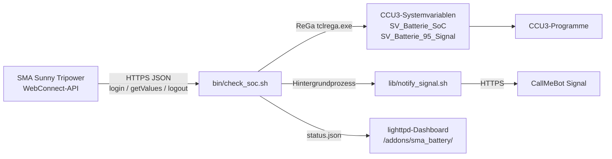

# Sentinella


Sentinella fragt alle zwei Minuten den Ladezustand (SoC) eines SMA Sunny Tripower oder Sunny Boy Storage über die lokale WebConnect-API ab, schreibt ihn in zwei Systemvariablen der HomeMatic CCU3 / RaspberryMatic (`SV_Batterie_SoC` und `SV_Batterie_95_Signal`) und sendet beim Überschreiten der Schaltschwellen optional eine Signal-Nachricht über CallMeBot.

## Überblick

- Läuft direkt auf einer unveränderten CCU3 oder RaspberryMatic mit `/bin/sh`, BusyBox `ash`, `curl`, `sed` und `lighttpd`.
- Kein Python, Node.js, Build-Schritt oder externes CDN auf der CCU.
- Rund 275 KB Speicherbedarf unter `/usr/local/`.
- Fehlgeschlagene oder unplausible Abfragen überschreiben nie den letzten gültigen Ladezustand.




### Ablauf eines Abrufs

1. `bin/check_soc.sh` lädt `.env`, prüft die Parameter und legt ein Sperrverzeichnis unter `state/` an (verwaiste PIDs werden aufgeräumt).
2. Das Skript meldet sich am Wechselrichter an (`POST /dyn/login.json`), liest den Batterie-SoC (`6100_00295A00`) sowie optional Lade- und Entladeleistung und meldet sich wieder ab (`POST /dyn/logout.json`).
3. Ist der Messwert keine ganze Zahl zwischen `0` und `100`, bricht der Lauf mit Exit-Code `1` ab; die CCU3-Variablen bleiben unverändert.
4. `SV_Batterie_95_Signal` schaltet ab `THRESHOLD_TRIGGER` (Standard `95%`) auf `true`, ab `THRESHOLD_RESET` (Standard `90%`) auf `false` und behält dazwischen den bisherigen Zustand.
5. Beide Variablen werden in einem `tclrega.exe`-Aufruf geschrieben, `status.json` wird atomar aktualisiert, und bei einem Schwellenwechsel startet `lib/notify_signal.sh` entkoppelt im Hintergrund.


## Voraussetzungen

- **CCU3 / RaspberryMatic**: ReGaHSS auf Port `8181`, Root-SSH-Zugang und ca. 275 KB freier Speicher unter `/usr/local/`.
- **SMA-Wechselrichter**: HTTPS-WebConnect von der CCU3 erreichbar, WebUI-Passwort mit Leserechten (`usr` oder `user`), Batteriekanal `6100_00295A00` (siehe [docs/PROTOCOL.md](docs/PROTOCOL.md) bei abweichender Firmware).
- **Arbeitsplatz** (für `deploy.sh` und Tests): `bash`, `ssh`, `tar`, `curl`, `openssl`, Python 3.8+.

## Installation

### Automatische Installation

```sh
git clone https://github.com/czett/sentinella.git
cd sentinella
cp .env.example .env
chmod 600 .env
${EDITOR:-vi} .env
```

Mindestens `SMA_IP` und `SMA_PASS` in `.env` eintragen und auf die CCU3 übertragen:

```sh
./deploy.sh -H 192.168.178.10
```

`deploy.sh` kopiert die Dateien nach `/usr/local/addons/sma_battery`, richtet das Dashboard unter `/usr/local/etc/config/addons/www/sma_battery/` ein, setzt die Dateirechte (`600` für `.env`, `755` für Skripte und CGI), trägt den Zwei-Minuten-Cron-Job ein, legt `SV_Batterie_SoC` und `SV_Batterie_95_Signal` an und führt einen ersten Testlauf aus. Eine vorhandene `.env` auf der CCU sowie bestehende Crontab-Einträge bleiben erhalten.

Optionen:

```sh
./deploy.sh --dry-run                  # geplante Schritte anzeigen, nichts ändern
./deploy.sh -H ccu3.local --skip-vars  # Systemvariablen nicht anlegen
./deploy.sh -H ccu3.local --skip-cron  # Cron-Eintrag nicht ändern
```

### Manuelle Installation

```sh
# 1. Dateien auf die CCU3 kopieren
ssh root@ccu3 "mkdir -p /usr/local/addons/sma_battery/state /usr/local/etc/config/addons/www/sma_battery/api"
tar -cf - -C . bin lib web setup_variables.sh .env \
  | ssh root@ccu3 "tar -xf - -C /usr/local/addons/sma_battery"

# 2. Rechte, Web-Dateien, Systemvariablen auf der CCU3 einrichten
ssh root@ccu3 '
  cd /usr/local/addons/sma_battery &&
  chown -R root:root . &&
  chmod 755 bin/check_soc.sh lib/notify_signal.sh setup_variables.sh &&
  chmod 600 .env &&
  cp web/index.html web/style.css web/app.js /usr/local/etc/config/addons/www/sma_battery/ &&
  cp web/api/config.cgi web/api/test_signal.cgi /usr/local/etc/config/addons/www/sma_battery/api/ &&
  chmod 755 /usr/local/etc/config/addons/www/sma_battery/api/*.cgi &&
  printf "%s\n" /usr/local/addons/sma_battery > /usr/local/etc/config/addons/www/sma_battery/api/addon_dir &&
  sh setup_variables.sh
'
```

Cron-Job eintragen (`crontab -e`, Vorlage in [`examples/crontab.txt`](examples/crontab.txt)):

```
*/2 * * * * /usr/local/addons/sma_battery/bin/check_soc.sh >/dev/null 2>&1
```

## Dashboard & Einstellungen

Unter `http://<ccu-adresse>/addons/sma_battery/` erreichbar (`?demo=1` lädt lokal Beispieldaten).

Das Dashboard liest `status.json` alle 30 Sekunden neu ein und bietet:

- **EN / DE**-Sprachumschalter (speichert `UI_LANGUAGE` über `api/config.cgi` in `.env`, sodass auch Signal-Nachrichten die gewählte Sprache nutzen).
- **Hell / Dunkel**-Umschalter (helles Design ist Standard; Auswahl wird in `localStorage` gespeichert).
- **Einstellungs-Menü** für Schaltschwellen, Signal-Alarme, Schnelleinrichtung per eingefügter CallMeBot-Aktivierungsnachricht sowie Wechselrichter-Zugangsdaten. Gespeichert wird atomar in `.env` (`chmod 600`); hinterlegte Passwörter und API-Schlüssel werden nie an den Browser ausgeliefert.


Aufbau von `status.json`:

```json
{
  "schema": 1,
  "ui_language": "de",
  "generated_at": "2026-11-06T16:30:00Z",
  "generated_epoch": 1762446600,
  "host": "192.168.178.123",
  "soc": 91,
  "previous_soc": 92,
  "delta": -1,
  "charging": "discharging",
  "charge_power_w": 0,
  "discharge_power_w": 620,
  "signal": true,
  "signal_state": "held",
  "signal_notifications": true,
  "thresholds": { "trigger": 95, "reset": 90 },
  "variables": { "soc": "SV_Batterie_SoC", "signal": "SV_Batterie_95_Signal" },
  "ccu_status": "ok",
  "history": [{ "t": 1762446600, "soc": 91 }]
}
```

## Schaltlogik


```
SoC
100 ┤
 95 ┤──────────── Ein (Trigger) ───────  → true
 92 ┤            bleibt                   (vorheriger Zustand unverändert)
 90 ┤──────────── Aus (Reset) ─────────  → false
  0 ┤
```

- Fehlt `state/signal` beim ersten Start und liegt der Ladezustand zwischen `THRESHOLD_RESET` und `THRESHOLD_TRIGGER`, wird `SV_Batterie_95_Signal` erst beim Erreichen einer Schwelle beschrieben.

| Situation | `SV_Batterie_SoC` | `SV_Batterie_95_Signal` | Exit-Code |
|---|---|---|---|
| Gültig `0..100` | aktualisiert | aktualisiert oder gehalten | `0` |
| `null`, fehlend oder außerhalb `0..100` | unverändert | unverändert | `1` |
| Wechselrichter- oder ReGaHSS-Fehler | unverändert | unverändert | `1` |
| Vorheriger Lauf noch aktiv | unverändert | unverändert | `0` |

## Konfiguration (`.env`)

### Wechselrichter

| Schlüssel | Standard | Beschreibung |
|---|---|---|
| `SMA_IP` | — | IPv4-Adresse oder Hostname des Wechselrichters |
| `SMA_PORT` | `443` | HTTPS-Port |
| `SMA_ROLE` | `usr` | Benutzerrolle (`usr` oder `user`) |
| `SMA_PASS` | — | Passwort der Wechselrichter-WebUI |
| `BATTERY_SOC_KEY` | `6100_00295A00` | Kanalschlüssel für den Batterie-SoC |
| `BATTERY_CHARGE_POWER_KEY` | `6100_00417800` | Ladeleistung in W (leer deaktiviert) |
| `BATTERY_DISCHARGE_POWER_KEY` | `6100_00417900` | Entladeleistung in W (leer deaktiviert) |
| `SMA_TLS_VERIFY` | `false` | TLS-Zertifikat prüfen (`false` nutzt `curl -k`) |
| `SMA_CONNECT_TIMEOUT` | `5` | Verbindungs-Timeout in Sekunden |
| `SMA_MAX_TIME` | `15` | Gesamt-Timeout pro Anfrage in Sekunden |
| `SMA_RETRIES` | `2` | Login-/Lese-/Logout-Versuche |
| `SMA_RETRY_DELAY` | `5` | Pause zwischen Versuchen in Sekunden |

### CCU3 & Schaltschwellen

| Schlüssel | Standard | Beschreibung |
|---|---|---|
| `CCU_IP` | `127.0.0.1` | CCU3-Adresse |
| `CCU_REGA_PORT` | `8181` | ReGaHSS-HTTP-Port |
| `SV_SOC_NAME` | `SV_Batterie_SoC` | Numerische Systemvariable (`0..100 %`) |
| `SV_SIGNAL_NAME` | `SV_Batterie_95_Signal` | Boolesche Systemvariable |
| `THRESHOLD_TRIGGER` | `95` | Einschaltschwelle in `%` (`true` ab diesem Wert) |
| `THRESHOLD_RESET` | `90` | Ausschaltschwelle in `%` (`false` ab oder unter diesem Wert) |
| `UI_LANGUAGE` | `en` | `en` oder `de` für Oberfläche und Signal-Standardtexte |

### Signal-Benachrichtigungen

#### CallMeBot einrichten

Sentinella versendet Meldungen über die [CallMeBot-Signal-API](https://www.callmebot.com/blog/free-api-signal-send-messages/). Die Einrichtung besteht aus zwei Schritten:

1. `I allow callmebot to send me messages` per Signal an CallMeBot senden. Der Bot antwortet mit den Zugangsdaten.
2. Die vollständige Antwort in das Feld **Schnelleinrichtung** im Einstellungs-Menü von Sentinella einfügen und **Extrahieren & Übernehmen** anklicken.

Sentinella liest die Signal-Account-UUID (oder Telefonnummer) und den API-Schlüssel aus dem Text und trägt beide Felder automatisch ein. Beim Speichern werden sie in `SIGNAL_PHONE` und `SIGNAL_APIKEY` geschrieben.

#### Konfiguration

| Schlüssel | Standard | Beschreibung |
|---|---|---|
| `SIGNAL_ENABLED` | `false` | Signal-Nachrichten über CallMeBot aktivieren |
| `SIGNAL_PHONE` | — | Telefonnummer (wird automatisch auf E.164 normalisiert, z. B. `+491711234567`) oder Signal-UUID |
| `SIGNAL_APIKEY` | — | CallMeBot-API-Schlüssel |
| `SIGNAL_API_URL` | CallMeBot-URL | Gateway-Endpunkt |
| `SIGNAL_MESSAGE_OVERFLOW` | eingebaut | Eigener Text beim Einschalten (`{SOC}`, `{TRIGGER_SOC}`, `{RESET_SOC}`) |
| `SIGNAL_MESSAGE_RESET` | eingebaut | Eigener Text beim Ausschalten |
| `SIGNAL_MESSAGE_TEST` | eingebaut | Eigener Text für `notify_signal.sh --test` |
| `SIGNAL_NOTIFY_ON_START` | `false` | Beim ersten Lauf senden, falls Signal bereits aktiv |
| `SIGNAL_TIMEOUT` | `15` | Timeout pro Sendeversuch in Sekunden |
| `SIGNAL_RETRIES` | `2` | Sendeversuche |
| `SIGNAL_COOLDOWN` | `3600` | Mindestabstand gleicher Meldungen in Sekunden |

Standardtexte:

| Ereignis | Englisch (`UI_LANGUAGE="en"`) | Deutsch (`UI_LANGUAGE="de"`) |
|---|---|---|
| Ein (Trigger) | `Sentinella: Battery reached {SOC}% (Trigger: {TRIGGER_SOC}%). Excess energy available.` | `Sentinella: Batteriespeicher bei {SOC}% (Schwelle: {TRIGGER_SOC}%). Überschuss verfügbar.` |
| Aus (Reset) | `Sentinella: Battery dropped below {RESET_SOC}% ({SOC}%). Overflow mode inactive.` | `Sentinella: Batteriespeicher unter {RESET_SOC}% gefallen ({SOC}%). Normalbetrieb aktiv.` |
| Test | `Sentinella: Connection verified. Telemetry and alert channel ready.` | `Sentinella: Verbindung erfolgreich getestet. Alarmsystem bereit.` |


Testnachricht über die Shell senden (ohne den gespeicherten Signalstatus zu ändern):

```sh
/usr/local/addons/sma_battery/lib/notify_signal.sh --test; echo "exit=$?"
```

### Web & Logging

| Schlüssel | Standard | Beschreibung |
|---|---|---|
| `WEB_ENABLED` | `true` | `status.json` in das lighttpd-Verzeichnis kopieren |
| `WEB_STATUS_FILE` | `/usr/local/etc/config/addons/www/sma_battery/status.json` | Zielpfad für das Dashboard |
| `WEB_HISTORY_POINTS` | `288` | Gespeicherte Messpunkte (~9,6 Std. bei 2-Minuten-Takt) |
| `LOG_FILE` | `<addon>/state/check_soc.log` | Logdatei (leer protokolliert nur nach syslog) |
| `LOG_MAX_BYTES` | `262144` | Logrotation ab dieser Dateigröße in Bytes |

## SMA-WebConnect-Kurzreferenz

Ausführliche Protokollbeschreibung in [docs/PROTOCOL.md](docs/PROTOCOL.md).

```sh
# 1. Login -> Sitzungs-ID (sid)
curl -k -sS -X POST -H 'Content-Type: application/json' \
  --data '{"right":"usr","pass":"secret"}' \
  https://192.168.178.123/dyn/login.json

# 2. Batterie-SoC abfragen
curl -k -sS -X POST -H 'Content-Type: application/json' \
  --data '{"destDev":[],"keys":["6100_00295A00"],"sid":"<sid>"}' \
  'https://192.168.178.123/dyn/getValues.json?sid=<sid>'

# 3. Logout
curl -k -sS -X POST -H 'Content-Type: application/json' \
  --data '{"destDev":[],"sid":"<sid>"}' \
  'https://192.168.178.123/dyn/logout.json?sid=<sid>'
```

## Fehlerbehebung

Details in [docs/TROUBLESHOOTING.md](docs/TROUBLESHOOTING.md). Schnellprüfung auf der CCU3:

```sh
/usr/local/addons/sma_battery/bin/check_soc.sh; echo "exit=$?"
tail -n 50 /usr/local/addons/sma_battery/state/check_soc.log
logread | grep sma_battery
curl -sS -o /dev/null -w '%{http_code}\n' http://127.0.0.1:8181/tclrega.exe
```

| Symptom | Ursache / Lösung |
|---|---|
| `login failed` / `err 401` | `SMA_PASS`, `SMA_ROLE` prüfen; WebUI-Konto evtl. vorübergehend gesperrt. |
| Wiederholte `getValues`-Fehler | Sitzungslimit am Wechselrichter erreicht; offene Browser-WebUI-Sitzungen schließen und doppelte Cron-Jobs prüfen. |
| `no numeric value` | Batterie im Standby oder abweichender Kanalschlüssel; siehe [docs/PROTOCOL.md](docs/PROTOCOL.md). |
| `CCU3 ReGa request failed` | ReGaHSS auf Port `8181` nicht erreichbar oder Systemvariablen fehlen (`sh setup_variables.sh`). |
| Keine Signal-Nachricht | `lib/notify_signal.sh --test` ausführen; `SIGNAL_PHONE` und `SIGNAL_APIKEY` prüfen. |

## Tests & Entwicklung

```sh
sh -n bin/check_soc.sh lib/notify_signal.sh web/api/config.cgi setup_variables.sh
shellcheck -s sh -S style bin/check_soc.sh lib/notify_signal.sh web/api/config.cgi setup_variables.sh
shellcheck -s bash -S style deploy.sh
node --check web/app.js
python3 tests/integration.py
```

Optionaler Speedwire-Multicast-Sniffer für den Arbeitsplatz (`239.12.255.254:9524`):

```sh
python3 tools/speedwire_sniffer.py --interface 192.168.178.10 --count 5
```

## Lizenz

MIT — siehe [LICENSE](LICENSE).
