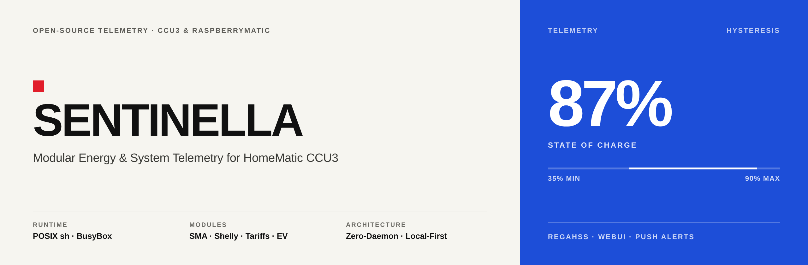
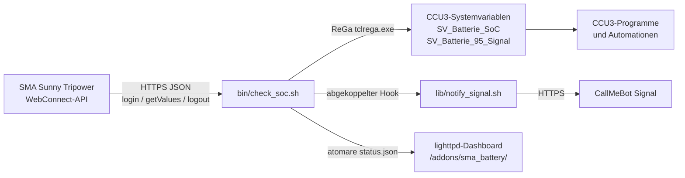
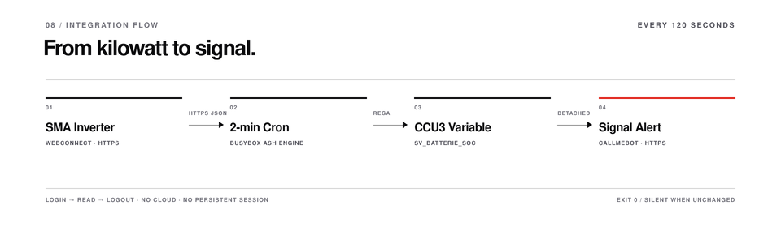
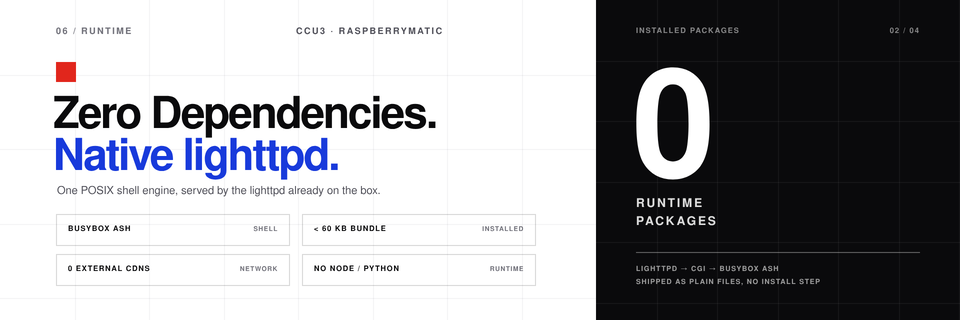
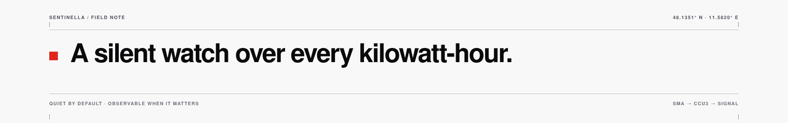
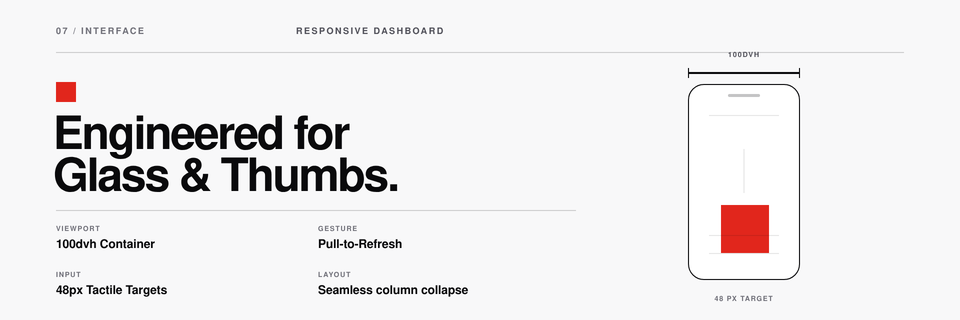
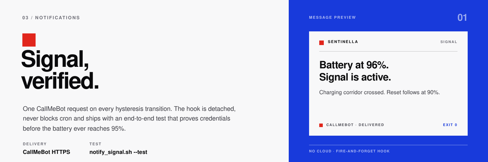

# Sentinella



Sentinella liest den Ladezustand (State of Charge, SoC) eines SMA Sunny Tripower oder Sunny Boy Storage über die lokale WebConnect-API, schreibt den Wert in eine Systemvariable der HomeMatic CCU3 / RaspberryMatic und schaltet daraus ein boolesches Signal mit 95-%-/90-%-Hysterese. Signal-Benachrichtigungen über CallMeBot sind optional.

## Eckdaten

- Läuft auf einer unveränderten CCU3 oder RaspberryMatic: POSIX `/bin/sh`, BusyBox `ash`, `curl`, `sed`, lighttpd.
- Kein Python, Node.js, Build-Schritt oder externes CDN auf der CCU.
- Unter 60 KB komprimiert; etwa 275 KB installiert unter `/usr/local/`, einschließlich der Dashboard-Kopie.
- Alle zwei Minuten ein Login-, Lese- und Logout-Zyklus über Cron.
- Ein fehlgeschlagener, fehlender oder ungültiger Messwert überschreibt nie den letzten gültigen SoC.
- Dashboard und Einstellungsoberfläche werden vom vorhandenen lighttpd ausgeliefert.

## Architektur





### Ablauf eines Laufs

1. `check_soc.sh` lädt `.env` und prüft alle Werte.
2. Unter `state/` wird ein Sperrverzeichnis angelegt. Ein laufender PID lässt den neuen Lauf still beenden; eine verwaiste Sperre wird entfernt.
3. Anmeldung (`POST /dyn/login.json`), Lesen von SoC und optionalen Leistungswerten, Abmeldung (`POST /dyn/logout.json`). Der Zyklus wird bis zu `SMA_RETRIES`-mal wiederholt.
4. Der SoC muss eine ganze Zahl von 0 bis 100 sein. Ungültige Werte beenden den Lauf, ohne die CCU3-Variablen zu verändern.
5. Die Hysterese wird mit dem gespeicherten Zustand ausgewertet. Zwischen den Schwellen bleibt der vorherige Zustand erhalten.
6. Beide CCU3-Variablen werden mit einer einzigen `tclrega.exe`-Anfrage geschrieben.
7. `state/status.json` wird atomar aktualisiert und bei aktiviertem Dashboard in das lighttpd-Verzeichnis kopiert.
8. Bei einem Zustandswechsel startet `lib/notify_signal.sh` im Hintergrund. Cron wartet nie auf die Benachrichtigung.



## Voraussetzungen

### CCU3 / RaspberryMatic

- Aktuelle CCU3- oder RaspberryMatic-Firmware mit ReGaHSS auf Port `8181`.
- `curl`, `sed`, `tr`, `cut`, `head`, `tail`, `date` und `logger`; alle sind im Standardimage enthalten.
- Root-SSH-Zugang für die Installation.
- Etwa 275 KB dauerhafter Speicher unter `/usr/local/`, einschließlich der Dashboard-Kopie.

### SMA-Wechselrichter

- Vom CCU3 aus über HTTPS erreichbar.
- Ein WebUI-Konto mit Lesezugriff. Standard ist die Installateur-Rolle `usr`; `user` funktioniert ebenfalls.
- Die Batterie ist in der WebUI sichtbar. Der Standardschlüssel für den SoC ist `6100_00295A00`; je nach Firmware ist ein anderer Schlüssel nötig (siehe [docs/PROTOCOL.md](docs/PROTOCOL.md)).

### Arbeitsplatz

Nur für `deploy.sh` und die Tests nötig: `bash`, `ssh`, `tar`, `curl`, Python 3.8+ und `openssl`.

## Installation

### 1. Quellcode holen

```sh
git clone https://github.com/czett/sentinella.git
cd sentinella
```

### 2. Konfigurieren

```sh
cp .env.example .env
chmod 600 .env
${EDITOR:-vi} .env
```

Mindestens setzen:

| Schlüssel | Bedeutung |
|---|---|
| `SMA_IP` | Adresse des Wechselrichters, z. B. `192.168.178.123` |
| `SMA_PASS` | Passwort der Wechselrichter-WebUI |
| `CCU_IP` | `127.0.0.1`, wenn der Monitor auf der CCU3 läuft |
| `DEPLOY_HOST` | CCU3-Adresse für `deploy.sh` |

`.env` muss Modus `600` behalten. Die Datei ist bereits in `.gitignore` eingetragen.

### 3. Installieren

```sh
./deploy.sh -H 192.168.178.10
```

`deploy.sh` ist idempotent und führt diese Schritte aus:

1. SSH-Verbindung prüfen.
2. `bin/`, `lib/`, `web/`, `setup_variables.sh` und `.env` per `tar` über SSH nach `/usr/local/addons/sma_battery` übertragen. `rsync` ist auf der CCU nicht nötig.
3. Eigentümer auf `root:root` setzen; Skripte und Verzeichnisse erhalten `755`, `.env` `600`, Dashboard-Dateien `644`, CGI-Endpunkte `755`.
4. Dashboard und Einstellungs-API nach `/usr/local/etc/config/addons/www/sma_battery/` installieren und den CGI-Endpunkt über lighttpd prüfen.
5. Den Zwei-Minuten-Cron-Eintrag anlegen, falls noch kein aktiver Eintrag existiert, und `crond` neu starten. Vorhandene Crontab-Zeilen bleiben erhalten.
6. `setup_variables.sh` ausführen und die beiden Systemvariablen anlegen.
7. Einen ersten Lauf ausführen und die Dashboard-URL ausgeben.

Eine vorhandene `.env` auf der CCU wird nicht überschrieben. Nur bei der Erstinstallation wird die Datei vom Arbeitsplatz kopiert.

Nützliche Optionen:

```sh
./deploy.sh --dry-run                  # nur planen, nichts ändern
./deploy.sh -H ccu3.local --skip-vars  # vorhandene Systemvariablen behalten
./deploy.sh -H ccu3.local --skip-cron  # Zeitsteuerung selbst übernehmen
```

### 4. Manuelle Installation

Auf der CCU3:

```sh
mkdir -p /usr/local/addons/sma_battery/state
mkdir -p /usr/local/etc/config/addons/www/sma_battery
```

Vom Arbeitsplatz:

```sh
tar -cf - -C . bin lib web setup_variables.sh .env \
  | ssh root@ccu3 "tar -xf - -C /usr/local/addons/sma_battery"
```

Auf der CCU3:

```sh
cd /usr/local/addons/sma_battery
chown -R root:root .
chmod 755 bin/check_soc.sh lib/notify_signal.sh setup_variables.sh
chmod 600 .env
mkdir -p /usr/local/etc/config/addons/www/sma_battery/api
cp web/index.html web/style.css web/app.js \
   /usr/local/etc/config/addons/www/sma_battery/
cp web/api/config.cgi web/api/test_signal.cgi \
   /usr/local/etc/config/addons/www/sma_battery/api/
chmod 755 /usr/local/etc/config/addons/www/sma_battery/api/*.cgi
printf '%s\n' /usr/local/addons/sma_battery \
   > /usr/local/etc/config/addons/www/sma_battery/api/addon_dir
```

### 5. Systemvariablen anlegen

```sh
cd /usr/local/addons/sma_battery
sh setup_variables.sh
```

Das Skript ist idempotent und legt an:

- `SV_Batterie_SoC` — Zahl, `0..100`, Einheit `%`
- `SV_Batterie_95_Signal` — Boolean

Beide werden unter `ID_SYSTEM_VARIABLES` registriert und erscheinen unter **Status und Bedienung → Systemvariablen**. Eine Rohfassung für den CCU3-Skripteditor liegt in [`examples/setup_variables.rega`](examples/setup_variables.rega).

### 6. Cron einrichten

Mit `deploy.sh` geschieht das automatisch. Für eine manuelle Installation die Zeile mit `crontab -e` ergänzen:

```
*/2 * * * * /usr/local/addons/sma_battery/bin/check_soc.sh >/dev/null 2>&1
```

Danach Cron neu starten:

```sh
killall crond 2>/dev/null
crond
```

Prüfen:

```sh
crontab -l
ps | grep crond
```

Eine vollständige Vorlage liegt in [`examples/crontab.txt`](examples/crontab.txt). Ein `rc.local`-Eintrag ist nicht nötig: Die CCU3 startet `crond` beim Booten, und die Root-Crontab liegt persistent unter `/etc/crontabs/root`. Wird sie durch ein Firmware-Update zurückgesetzt, `./deploy.sh` erneut ausführen.

### 7. Dashboard öffnen

```
http://<ccu-adresse>/addons/sma_battery/
```

Der erste Wert erscheint nach dem nächsten Cron-Lauf, spätestens nach zwei Minuten. Die Seite aktualisiert sich alle 30 Sekunden und zeigt „Warte auf erste Messung“, solange `status.json` fehlt. Mit `?demo=1` lässt sich das Layout mit Beispieldaten ansehen; der Hinweis „Sentinella Preview Data“ kennzeichnet sie als Vorschau.

### 8. Einstellungen im Browser

Die Einstellungstaste im Kopfbereich des Dashboards öffnet eine Schublade für:

- Trigger- und Reset-Schwelle des SoC,
- den Signal-Schalter,
- Telefonnummer oder Signal-UUID und CallMeBot-API-Schlüssel,
- SMA-Adresse, HTTPS-Port und WebUI-Passwort.

**Test notification** speichert das Formular und startet dann `lib/notify_signal.sh --test` im Hintergrund. Die Schublade fragt das Ergebnis ab und meldet Erfolg oder Fehler. Ein Test verändert weder `state/signal` noch den Cooldown.

**Save configuration** schreibt `.env` atomar: Eine private Kopie wird bearbeitet und mit `mv` über die Originaldatei gelegt. Ein Cron-Lauf liest dadurch immer entweder die vollständige alte oder die vollständige neue Datei. Ist Signal aktiviert, startet ein erfolgreiches Speichern sofort denselben Hintergrundtest. Eine falsche Telefonnummer, UUID oder ein falscher API-Schlüssel wird damit gemeldet, ohne auf einen echten Trigger zu warten. Das Formular bleibt während des Versands bedienbar. Die Datei bleibt `chmod 600`. Geheimnisse werden nie an den Browser zurückgegeben: Die API liefert nur `signal_apikey_set` und `sma_password_set`; ein leeres Geheimnisfeld behält den gespeicherten Wert.

Die API akzeptiert nur Same-Origin-Anfragen und prüft jeden Wert: SoC `0..100`, Trigger über Reset, E.164-Nummer oder Signal-UUID, Hostname und Portbereich. Sie wird über `api/config.cgi` und `api/test_signal.cgi` ausgeliefert. Falls die Firmware `.cgi`-Dateien unter `/addons/` nicht ausführt, siehe [den CGI-Abschnitt in der Fehlerbehebung](docs/TROUBLESHOOTING.md#settings-panel-and-cgi).

## Konfiguration

Alle Schlüssel stehen in `.env`. Die Datei wird von `/bin/sh` eingelesen; Werte quoten und für Geheimnisse einfache Anführungszeichen verwenden. Nach der Installation lassen sich die häufigen Einstellungen auch im Dashboard ändern.

### Wechselrichter

| Schlüssel | Typ | Standard | Beschreibung |
|---|---|---|---|
| `SMA_IP` | Host | — | IPv4-Adresse oder DNS-Name, ohne Schema |
| `SMA_PORT` | int | `443` | HTTPS-Port der WebUI |
| `SMA_ROLE` | `usr`/`user` | `usr` | WebUI-Rolle |
| `SMA_PASS` | Geheimnis | — | WebUI-Passwort |
| `BATTERY_SOC_KEY` | String | `6100_00295A00` | SoC-Kanalschlüssel |
| `BATTERY_CHARGE_POWER_KEY` | String | `6100_00417800` | optionaler Ladeleistungsschlüssel; leer deaktiviert |
| `BATTERY_DISCHARGE_POWER_KEY` | String | `6100_00417900` | optionaler Entladeleistungsschlüssel; leer deaktiviert |
| `SMA_TLS_VERIFY` | bool | `false` | Zertifikat prüfen (`false` = `curl -k`) |
| `SMA_CONNECT_TIMEOUT` | int | `5` | Verbindungs-Timeout in Sekunden |
| `SMA_MAX_TIME` | int | `15` | Gesamt-Timeout pro Anfrage in Sekunden |
| `SMA_RETRIES` | int | `2` | vollständige Login-/Lese-/Logout-Zyklen |
| `SMA_RETRY_DELAY` | int | `5` | Sekunden zwischen Versuchen |

### CCU3

| Schlüssel | Typ | Standard | Beschreibung |
|---|---|---|---|
| `CCU_IP` | Host | `127.0.0.1` | CCU-Adresse; lokal, wenn auf der CCU ausgeführt |
| `CCU_REGA_PORT` | int | `8181` | ReGaHSS-HTTP-Port |
| `SV_SOC_NAME` | Identifier | `SV_Batterie_SoC` | numerische Systemvariable |
| `SV_SIGNAL_NAME` | Identifier | `SV_Batterie_95_Signal` | boolesche Systemvariable |
| `THRESHOLD_TRIGGER` | int 0..100 | `95` | Signal ab diesem SoC auf `true` |
| `THRESHOLD_RESET` | int 0..100 | `90` | Signal ab diesem SoC auf `false` |

`THRESHOLD_TRIGGER` muss größer als `THRESHOLD_RESET` sein. Variablennamen dürfen nur Buchstaben, Ziffern und Unterstriche enthalten.

### Benachrichtigungen

| Schlüssel | Typ | Standard | Beschreibung |
|---|---|---|---|
| `SIGNAL_ENABLED` | bool | `false` | CallMeBot-Signal aktivieren |
| `SIGNAL_PHONE` | String | — | E.164-Nummer mit `+` |
| `SIGNAL_APIKEY` | Geheimnis | — | CallMeBot-API-Schlüssel |
| `SIGNAL_API_URL` | URL | CallMeBot-Signal | kompatibles Gateway |
| `SIGNAL_MESSAGE_OVERFLOW` | String | siehe `.env.example` | Überschuss-Meldung; Platzhalter `{SOC}`, `{TRIGGER_SOC}`, `{RESET_SOC}`, `{HOST}` |
| `SIGNAL_MESSAGE_RESET` | String | siehe `.env.example` | Reset-Meldung; gleiche Platzhalter |
| `SIGNAL_MESSAGE_TEST` | String | siehe `.env.example` | Text für `notify_signal.sh --test` |
| `SIGNAL_NOTIFY_ON_START` | bool | `false` | beim ersten Lauf melden, wenn das Signal bereits aktiv ist |
| `SIGNAL_TIMEOUT` | int | `15` | Timeout der Meldung |
| `SIGNAL_RETRIES` | int | `2` | Versuche der Meldung |
| `SIGNAL_COOLDOWN` | int | `3600` | gleiche Trigger-/Reset-Meldung innerhalb dieser Sekunden unterdrücken |

Meldungen werden nur bei einem Hysterese-Wechsel (`false → true` und `true → false`) und erst nach erfolgreichem CCU3-Schreiben gesendet. Der Hook läuft mit `setsid`/`nohup` abgekoppelt und verzögert Cron nicht. Eine Sperrzeit pro Ereignis verhindert Doppelmeldungen bei einem Zwei-Minuten-Cron oder einem verlorenen Zustand. `curl --data-urlencode` kodiert den Text, damit Leerzeichen, Umlaute und `ß` ohne Python oder jq auf BusyBox funktionieren. Die alten Schlüssel `SIGNAL_TEXT_TRIGGER`/`SIGNAL_TEXT_RESET` und `%SOC%`-Platzhalter bleiben gültig.

### Dashboard und Logging

| Schlüssel | Typ | Standard | Beschreibung |
|---|---|---|---|
| `WEB_ENABLED` | bool | `true` | `status.json` veröffentlichen |
| `WEB_STATUS_FILE` | Pfad | `/usr/local/etc/config/addons/www/sma_battery/status.json` | lighttpd-Ziel |
| `WEB_HISTORY_POINTS` | int | `288` | Punkte im Diagramm (2 min × 288 ≈ 9,6 h) |
| `LOG_FILE` | Pfad | `<addon>/state/check_soc.log` | lokales Log; leer deaktiviert die Dateiausgabe |
| `LOG_MAX_BYTES` | int | `262144` | Rotation oberhalb dieser Größe |

### Installation

| Schlüssel | Typ | Standard | Beschreibung |
|---|---|---|---|
| `DEPLOY_HOST` | Host | — | CCU3-SSH-Adresse für `deploy.sh` |
| `DEPLOY_USER` | String | `root` | SSH-Benutzer |
| `DEPLOY_PORT` | int | `22` | SSH-Port |
| `DEPLOY_ADDON_DIR` | Pfad | `/usr/local/addons/sma_battery` | entferntes Add-on-Verzeichnis |
| `DEPLOY_WEB_DIR` | Pfad | `/usr/local/etc/config/addons/www/sma_battery` | entferntes Dashboard-Verzeichnis |



## Signallogik

Der Boolean ist ein Schmitt-Trigger:


```
SoC
100 ┤
 95 ┤──────────── Trigger ────────────  → true
 92 ┤            halten                  (vorheriger Zustand bleibt)
 90 ┤──────────── Reset ───────────────  → false
  0 ┤
```

- Ab `THRESHOLD_TRIGGER` wird das Signal `true`.
- Ab `THRESHOLD_RESET` wird es `false`.
- Dazwischen wird der Wert aus `state/signal` verwendet.
- Fehlt die Zustandsdatei und liegt der SoC im Totband, wird der Boolean absichtlich **nicht geschrieben**. Das verhindert einen vorzeitigen Reset nach einer Neuinstallation oder einem verlorenen Zustand. Das Dashboard zeigt dann `signal: null` und `signal_state: "unknown"`.

Das Fehlerverhalten ist bewusst konservativ:

| Zustand | CCU3-SoC | CCU3-Signal | Exit |
|---|---|---|---|
| gültig 0..100 | geschrieben | geschrieben oder gehalten | 0 |
| `null` / fehlend | unverändert | unverändert | 1 |
| nicht ganzzahlig / `101` / `-1` | unverändert | unverändert | 1 |
| Login- oder `getValues`-Fehler | unverändert | unverändert | 1 |
| ReGa-Anfrage fehlgeschlagen | unverändert | unverändert | 1 |
| anderer Lauf aktiv | unverändert | unverändert | 0 |

## Dashboard

Das Dashboard ist eine statische Single-Page-App ohne externe Schriften, Skripte oder CDNs. Es liest `status.json` alle 30 Sekunden und zeigt SoC, Ladezustand, Hysterese-Leiste, Batterieleistung, das CCU3-Schreibergebnis, den Zeitpunkt der letzten Messung, ein Verlaufsdiagramm und ein Systemregister mit Wechselrichter-Host, Variablennamen, Signal-Gateway und Zeitstempel. Pull-to-Refresh wird auf Mobilgeräten unterstützt; die Aktualität zeigen die Werte selbst und ein Hinweisstreifen bei fehlgeschlagenem Abruf.



`status.json` wird atomar geschrieben und enthält keine Geheimnisse:

```json
{
  "schema": 1,
  "generated_at": "2026-11-06T16:30:00Z",
  "generated_epoch": 1762446600,
  "host": "192.168.178.123",
  "soc": 91,
  "previous_soc": 92,
  "delta": -1,
  "charging": "discharging",
  "charge_power_w": 0,
  "discharge_power_w": 620,
  "signal": true,
  "signal_state": "held",
  "signal_notifications": true,
  "thresholds": { "trigger": 95, "reset": 90 },
  "variables": { "soc": "SV_Batterie_SoC", "signal": "SV_Batterie_95_Signal" },
  "ccu_status": "ok",
  "history": [{ "t": 1762446600, "soc": 91 }]
}
```

Für eine lokale Vorschau ohne CCU3 `web/status.example.json` nach `web/status.json` kopieren und `web/` mit einem beliebigen statischen Server ausliefern, oder die Seite mit `?demo=1` öffnen.

Wird kein Dashboard benötigt: `WEB_ENABLED="false"`. Der Monitor schreibt weiterhin einen privaten Snapshot nach `<addon>/state/status.json`.

## SMA-WebConnect-Notizen

Die vollständigen Notizen inklusive Schlüsselsuche und Sitzungslimits stehen in [docs/PROTOCOL.md](docs/PROTOCOL.md). Kurzfassung:

```sh
# 1. Login -> sid
curl -k -sS -X POST -H 'Content-Type: application/json' \
  --data '{"right":"usr","pass":"secret"}' \
  https://192.168.178.123/dyn/login.json

# 2. Batterie-SoC lesen
curl -k -sS -X POST -H 'Content-Type: application/json' \
  --data '{"destDev":[],"keys":["6100_00295A00"],"sid":"<sid>"}' \
  'https://192.168.178.123/dyn/getValues.json?sid=<sid>'

# 3. immer abmelden
curl -k -sS -X POST -H 'Content-Type: application/json' \
  --data '{"destDev":[],"sid":"<sid>"}' \
  'https://192.168.178.123/dyn/logout.json?sid=<sid>'
```

`6100_00295A00` ist der Standardschlüssel für den Batterie-SoC bei Sunny Tripower und Sunny Boy Storage. Je nach Firmware kann er abweichen; siehe Protokollnotizen. Die optionalen Leistungsschlüssel `6100_00417800` und `6100_00417900` verbessern die Anzeige von Laden und Entladen, sind aber nicht erforderlich. Ohne sie leitet das Dashboard den Zustand aus dem SoC-Verlauf ab.

## Signal-Benachrichtigungen

1. CallMeBot-Signal-Bot zum Telefon hinzufügen und den API-Schlüssel nach Anleitung aktivieren.
2. Nummer und Schlüssel in `.env` eintragen:

```sh
SIGNAL_ENABLED="true"
SIGNAL_PHONE="+491701234567"
SIGNAL_APIKEY="123456"
```

3. `./deploy.sh` erneut ausführen oder die aktualisierte `.env` kopieren und auf Modus `600` setzen. Ein erneutes Deployment behält die vorhandene `.env` auf der CCU und überschreibt keine Zugangsdaten.
4. Zugangsdaten und Zustellung testen, ohne einen Batteriezustand zu erzeugen:

```sh
/usr/local/addons/sma_battery/lib/notify_signal.sh --test; echo "exit=$?"
```

`--test` sendet eine klar gekennzeichnete Testnachricht und liest oder schreibt `state/signal` nicht. `deploy.sh` startet denselben Test automatisch, wenn `SIGNAL_ENABLED="true"` gesetzt ist und `--skip-test` fehlt.



Der Notifier schreibt in dasselbe Log und in syslog mit Tag `sma_battery_notify`.

## Fehlerbehebung

Die ausführliche Anleitung steht in [docs/TROUBLESHOOTING.md](docs/TROUBLESHOOTING.md). Schnellprüfungen:

```sh
# einmal im Vordergrund ausführen
/usr/local/addons/sma_battery/bin/check_soc.sh; echo "exit=$?"

# letzte Logzeilen
tail -n 50 /usr/local/addons/sma_battery/state/check_soc.log
logread | grep sma_battery

# läuft Cron?
ps | grep crond
crontab -l

# ist ReGaHSS erreichbar?
curl -sS -o /dev/null -w '%{http_code}\n' http://127.0.0.1:8181/tclrega.exe
```

Häufige Ursachen:

| Symptom | Wahrscheinliche Ursache |
|---|---|
| `login failed` / `err 401` | falsches Passwort, falsche Rolle oder WebUI-Benutzer gesperrt |
| wiederholter `getValues`-Fehler | alte Sitzung noch offen; einige Minuten warten und doppelte Cron-Jobs prüfen |
| `no numeric value` | Batterie nicht verbunden, falscher `BATTERY_SOC_KEY` oder Firmware bietet den Wert nicht an |
| `CCU3 ReGa request failed` | ReGaHSS läuft nicht, falscher `CCU_REGA_PORT` oder CCU3 überlastet |
| Variablen fehlen | `setup_variables.sh` ausführen; Namen sind groß-/kleinschreibungssensitiv |
| Dashboard zeigt „Warte auf erste Messung“ | erster Cron-Lauf noch nicht fertig oder `WEB_STATUS_FILE` liegt außerhalb des lighttpd-Verzeichnisses |
| Dashboard zeigt „Showing last recorded state“ | letzter Abruf fehlgeschlagen; Cron und Log prüfen |
| Wechselrichter nachts nicht erreichbar | Gerät kann bei leerer Batterie in den Standby wechseln; der letzte CCU3-Wert bleibt unverändert |
| keine Signal-Nachricht | Telefonnummer nicht im E.164-Format (`+49…`), falscher API-Schlüssel oder CallMeBot-Ratenlimit; `notify_signal.sh --test` ausführen und Log prüfen |
| keine Logdatei | `LOG_FILE` ist leer oder zeigt außerhalb von `/usr/local/`; Standard ist `<addon>/state/check_soc.log`, syslog-Tag `sma_battery` |

### BusyBox- und CCU3-Besonderheiten

- `#!/bin/sh` verwenden, nicht bash. Keine `local`, Arrays, `[[ ]]`, Prozess-Substitution, `set -u`-Annahmen oder `date -d`.
- Das `curl` der CCU3 kann älter sein. Die Skripte nutzen nur `-sS`, `-k`, `-m`, `--connect-timeout`, `--data-binary` und `--data-urlencode`.
- `/` ist auf der CCU3 schreibgeschützt. Dauerhafte Daten gehören unter `/usr/local/`.
- Cron startet mit minimaler Umgebung. `check_soc.sh` setzt seinen `PATH` selbst.
- Manuell geöffnete SMA-WebUI-Sitzungen abmelden. Der Wechselrichter erlaubt nur wenige parallele Sitzungen und kann neue Logins vorübergehend ablehnen.
- Eine verlorene `state/signal`-Datei führt im Totband nicht zu einem Reset; der Monitor hält den Boolean und protokolliert `signal=unchanged`.

## Sicherheit

- `.env` enthält das Wechselrichter-Passwort und den CallMeBot-API-Schlüssel. Die Datei ist in Git ignoriert, wird mit Modus `600` installiert und bei falschem Modus gemeldet.
- SMA-Geräte verwenden standardmäßig ein selbstsigniertes Zertifikat; `SMA_TLS_VERIFY="false"` ist daher die funktionierende Voreinstellung. `"true"` erst nach Installation eines vertrauenswürdigen Zertifikats am Wechselrichter setzen.
- ReGaHSS wird lokal über HTTP angesprochen. Port `8181` nicht ins Internet freigeben.
- `status.json` enthält nur SoC, Schwellen, Variablennamen und die Wechselrichter-Adresse. Kein Passwort, keine Sitzungs-ID und kein API-Schlüssel.
- Sperr- und Zustandsdateien haben Modus `700`/`600`.
- Das Skript meldet sich pro Lauf an, liest und meldet sich wieder ab. Zwischen Cron-Läufen bleibt keine Sitzung offen.

## Entwicklung und Tests

```sh
# POSIX-Syntax
sh -n bin/check_soc.sh
sh -n lib/notify_signal.sh
sh -n setup_variables.sh

# ShellCheck (POSIX-Profil)
shellcheck -s sh -S style bin/check_soc.sh lib/notify_signal.sh setup_variables.sh

# Bash-Installationshelfer
shellcheck -s bash -S style deploy.sh

# JavaScript-Syntax
node --check web/app.js

# Ende-zu-Ende-Tests mit Mock-SMA und Mock-ReGa
python3 tests/integration.py
```

Der Integrationstest startet einen selbstsignierten HTTPS-SMA-Mock und einen HTTP-ReGa-Mock und prüft erfolgreiche Läufe, Hysterese-Wechsel, das Halten bei unbekanntem Zustand, `null`- und außerhalb-des-Bereichs-Werte, Login-Fehler, die Sperre, Logout bei `SIGTERM`, abgekoppelte Benachrichtigungen und das ReGa-Setup.

### Bildmaterial

Die Bilder in [`docs/assets/`](docs/assets) folgen dem Raster des Dashboards: warmes Papier, Ultramarin-Flächen, signalrote Quadrate und Helvetica-Schrift. Die Dateien werden einmalig mit Headless Chrome in 2× gerendert und herunterskaliert. Das Dashboard lädt sie zur Laufzeit nicht.

| Datei | Größe | Verwendung |
|---|---|---|
| `readme-hero-banner.png` | 1280 × 420 | Kopf des Repositorys |
| `sentinella-icon.png` | 512 × 512 | App-Symbol und Avatar |
| `favicon.ico` | 16–64 | Browser-Favicon |
| `feature-diagram-hysteresis.png` | 960 × 320 | Erklärung der zwei Schwellen |
| `feature-card-signal.png` | 960 × 320 | CallMeBot-Signal-Vorschau |
| `feature-card-native-ccu.png` | 960 × 320 | Laufzeit ohne Abhängigkeiten |
| `feature-card-mobile-touch.png` | 960 × 320 | mobiles Dashboard |
| `feature-diagram-telemetry.png` | 960 × 280 | Weg von Cron zu Signal |
| `readme-divider-quote.png` | 1280 × 200 | Abschnittstrenner |
| `social-preview-og.png` | 1280 × 640 | GitHub-Social-Preview |

`social-preview-og.png` in den GitHub-Einstellungen als Social-Preview-Bild hinterlegen. Coderegeln stehen in [CONTRIBUTING.md](CONTRIBUTING.md).

## Migration vom alten `sma_soc`-Add-on

Das neue Layout ersetzt `config.env` durch `.env`. Existiert keine `.env`, liest der Kern übergangsweise weiterhin `config.env`.

| Alter Schlüssel | Neuer Schlüssel |
|---|---|
| `SMA_HOST` | `SMA_IP` |
| `SMA_SOC_KEY` | `BATTERY_SOC_KEY` |
| `SMA_INSECURE="1"` | `SMA_TLS_VERIFY="false"` |
| `SMA_INSECURE="0"` | `SMA_TLS_VERIFY="true"` |
| `SV_SIGNAL_ON` | `THRESHOLD_TRIGGER` |
| `SV_SIGNAL_OFF` | `THRESHOLD_RESET` |
| `CCU_REGA_URL` | `CCU_IP` + `CCU_REGA_PORT` |
| `SV_SOC_NAME` | unverändert |
| `SV_SIGNAL_NAME` | unverändert |

Das Standardverzeichnis ist jetzt `/usr/local/addons/sma_battery`; mit `deploy.sh --dir` lässt sich der alte Pfad beibehalten.

## Optionales Diagnosewerkzeug

`tools/speedwire_sniffer.py` hört auf SMA-Speedwire-Multicast-Telegramme auf `239.12.255.254:9524`. Der Monitor benötigt es nicht, es hilft aber zu prüfen, ob der Wechselrichter im Netz ist und ob herstellerspezifische Batteriekanäle vorhanden sind. Es benötigt Python auf dem Arbeitsplatz, nicht auf der CCU3.

```sh
python3 tools/speedwire_sniffer.py --interface 192.168.178.10 --count 5
```

## Lizenz

MIT — siehe [LICENSE](LICENSE).
