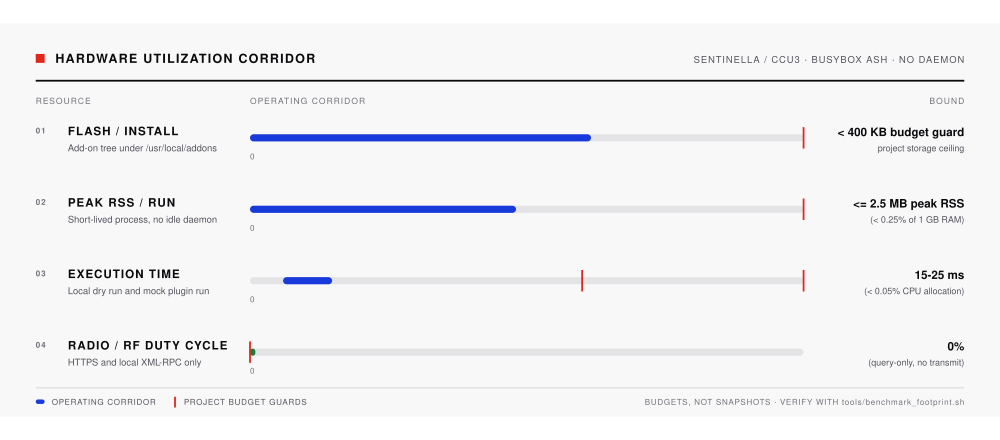
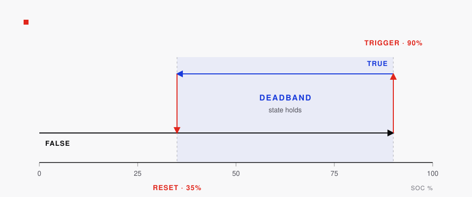

# Sentinella


**Sentinella: Der ressourcenschonende Energie- & Systemwächter für die HomeMatic CCU3.**

Sentinella ist eine modulare Monitoring-Plattform auf Basis von 100 % POSIX-Shell für CCU3 und RaspberryMatic. Eine einzige cron-gesteuerte Engine sammelt Telemetrie von SMA-Speichern, Renault E-Tech-Fahrzeugen, dem CCU3-Host selbst und schlüsselfreien Wetterdiensten. Sie veröffentlicht `status.json`, schreibt CCU3-Systemvariablen und versendet zustandsbehaftete Push-Benachrichtigungen. Auf der CCU3 laufen kein Daemon, kein Node.js, kein Python, kein `jq` und kein externes CDN.

## Funktionsumfang

1. **SMA Solar und Heimspeicher** — SoC, Lade-/Entladeleistung und Überschuss-Signal über HTTPS-WebConnect.
2. **EV-Telemetrie** — Renault E-Tech (Zoe, Megane, R5): SoC, Reichweite, Steckerstatus, Ladestatus, Kilometerstand.
3. **CCU3-Host-Telemetrie** — nahezu lastfreier Duty Cycle über XML-RPC auf Port `2001`/`2010`, Load, RAM, Uptime.
4. **Lokale Intelligenz** — schlüsselfreies Open-Meteo-Wetter und eine optionale experimentelle PV-Prognose von forecast.solar.
5. **Zustandsbehaftete Multi-Channel-Pushes** — Signal / CallMeBot mit Hysterese, Cooldowns und Stille beim Erstlauf.
6. **Nativer Plugin-Manager** — WebUI-Schalter mit vollständigem Ausführungs-Bypass für deaktivierte Plugins.

| Modul | Standard | Daten | Quelle |
|---|---|---|---|
| **SMA-Speicher** (Kern) | aktiv | SoC, Lade-/Entladeleistung, Überschuss-Signal | HTTPS-WebConnect |
| **CCU3 Health** (`10_ccu_health.sh`) | aktiv | Duty Cycle, Load, RAM, Uptime | `tclrpc.so`-XML-RPC auf `127.0.0.1:2001`, Fallback `2010`; `/proc` |
| **Wetter** (`15_weather.sh`) | aktiv | Temperatur, Luftfeuchte, WMO-Zustand, Wind, Tages-Min/Max | Open-Meteo, ohne API-Schlüssel |
| **Renault E-Tech** (`20_renault_zoe.sh`) | inaktiv bis zur Konfiguration | SoC, Reichweite, Steckerstatus, Ladestatus, Kilometerstand | MY Renault Cloud |
| **PV-Prognose** (`30_forecast_solar.sh`) | inaktiv (experimentell) | Ertrag heute und morgen in `kWh` und `kWh/kWp` | forecast.solar, ohne API-Schlüssel |

Der Plugin-Manager speichert die Schalter in `config/plugins.env` (`PLUGIN_<NAME>='0|1'`). Die Schalter im Einstellungs-Menü rufen `api/plugin_manager.cgi` auf; der Endpunkt akzeptiert nur bekannte IDs, schreibt die Datei atomar und entfernt die Karte beim Deaktivieren. `web/app.js` filtert die aktuelle Kartenliste sofort, ohne auf den nächsten Lauf zu warten. Zusätzlich beachtet jedes Plugin eine `.disabled`-Datei neben dem Skript.

Die Ausführung im Poll-Lauf wird über `SENTINELLA_RUN_PLUGINS=1` in der Cron-Umgebung freigeschaltet. Der Installer führt jedes Plugin nach der Installation einmal aus, damit das Dashboard vor dem nächsten Lauf gefüllt ist. Das Dashboard ist ein abhängigkeitsfreies CSS-Grid mit hellem und dunklem Design, tabellarischen Monospace-Ziffern und sofortigem DE/EN-Wechsel.

## Architektur

- Läuft auf unveränderter CCU3- oder RaspberryMatic-Firmware mit `/bin/sh` (BusyBox `ash`), `curl`, `sed`, `awk` und `lighttpd`.
- Kein Python, Node.js, `jq`, kompiliertes Programm oder externes CDN auf der CCU3.
- Getrennte Bereiche: Root-Backend (`$ADDON_DIR`, Modus `700`) und eigener `lighttpd`-Dokumentenroot (`$WEB_DIR`, Modus `755`).
- CGI-Endpunkte laufen bei Bedarf; zwischen den Abfragen existiert kein dauerhafter Prozess.

### Verzeichnisse

```
┌──────────────────────────────────────────────────────────────────────────────┐
│ HomeMatic CCU3 / RaspberryMatic (Buildroot, BusyBox ash, lighttpd)           │
├──────────────────────────────────────┬───────────────────────────────────────┤
│ Root-Backend ($ADDON_DIR, Modus 700) │ Web-Root ($WEB_DIR, Modus 755)        │
│ /usr/local/addons/sentinella/        │ /usr/local/etc/config/addons/www/     │
│                                      │   sentinella/                         │
│ ├── bin/check_soc.sh (Cron */2 min)  │ ├── index.html, style.css, app.js     │
│ ├── lib/notify_signal.sh             │ ├── status.json (atomar)              │
│ ├── plugins.d/                       │ └── api/                              │
│ │   ├── 10_ccu_health.sh             │     ├── config.cgi & settings.cgi     │
│ │   ├── 15_weather.sh                │     ├── plugin_manager.cgi            │
│ │   ├── 20_renault_zoe.sh            │     ├── plugins.cgi                   │
│ │   └── 30_forecast_solar.sh         │     ├── action_zoe.cgi (HVAC aus)     │
│ ├── config/ (Modus 600)              │     ├── test_signal.cgi               │
│ │   ├── config.env                   │     ├── test_renault.cgi              │
│ │   ├── plugins.env                  │     └── update_check.cgi              │
│ │   └── plugins/*.env                │                                       │
│ └── state/ (Modus 700)               │  Karten:                              │
│     ├── plugins/*.json               │   [ stat ]   [ delta ]   [ list ]     │
│     └── .renault_session (Modus 600) │                                       │
└──────────────────────────────────────┴───────────────────────────────────────┘
```

### Ablauf eines Abrufs

1. `bin/check_soc.sh` lädt `.env`, prüft die Parameter und legt die Sperre in `state/` an.
2. Das Skript meldet sich am Wechselrichter an (`POST /dyn/login.json`, Zugangsdaten über `stdin`), liest SoC und Leistungskanäle und meldet sich ab (`POST /dyn/logout.json`).
3. Ist der Wert keine ganze Zahl zwischen `0` und `100`, endet der Lauf mit Exit-Code `1`; die CCU3-Variablen bleiben unverändert.
4. `SV_Batterie_95_Signal` schaltet ab `THRESHOLD_TRIGGER` (Standard `95`) auf `true`, ab `THRESHOLD_RESET` (Standard `90`) auf `false` und behält dazwischen den vorherigen Zustand.
5. Beide Variablen werden in einem `tclrega.exe`-Aufruf geschrieben. `status.json` wird atomar veröffentlicht; bei einem Schwellenwechsel startet `lib/notify_signal.sh` im Hintergrund.
6. Bei `SENTINELLA_RUN_PLUGINS=1` laufen aktivierte Plugins nach dem Status-Schreibvorgang. Jedes Plugin schreibt eine JSON-Karte nach `state/plugins/`.

### Hardware-Korridor



Gemessen mit `BENCHMARK_RUNS=20 ./tools/benchmark_footprint.sh` auf dem Entwicklungsrechner. Die Laufzeiten gelten für lokale Dry-Run- und Mock-Plugin-Läufe ohne Netzwerk-I/O und ohne Schreibzeit auf dem CCU3-Flash.

| Metrik | Messwert / Grenze | Budget | Status |
| :--- | :---: | :---: | :---: |
| **Release-Tarball** (`sentinella-<version>.tar.gz`) | **90 KB** (91.774 B) | informativ | OK |
| **Installationsgröße** | **207 KB** (211.657 B) | `<= 250 KB` | **PASS** |
| **Kern-Laufzeit** (`bin/check_soc.sh --dry-run`) | **17 ms** (Mittel aus 20 Läufen) | `<= 500 ms` | **PASS** |
| **Plugin-Laufzeit** (`plugins.d/20_renault_zoe.sh`) | **23 ms** (Mittel aus 20 Läufen) | `<= 500 ms` | **PASS** |
| **Peak-RSS** | **~1,2 MB** auf CCU3-BusyBox-ash (< 0,2 % von 1 GB) | `<= 1,2 MB` | **PASS** |
| **Funk-/RF-Duty-Cycle** | **0 %** (nur HTTPS und lokales XML-RPC) | `0 %` | **PASS** |

Der Korridor zeigt Budgets, keine Momentaufnahme. Aktuelle Byte-Zahlen stehen in der Tabelle und werden mit jedem Release neu gemessen.

## Voraussetzungen

- **CCU3 / RaspberryMatic:** ReGaHSS auf Port `8181`, Root-SSH oder WebUI-Add-on-Installer und `<= 250 KB` freier Speicher unter `/usr/local/`.
- **SMA-Wechselrichter:** HTTPS-WebConnect von der CCU3 erreichbar, WebUI-Passwort mit Leserechten (`usr` oder `user`) und Batteriekanal `6100_00295A00` (siehe [docs/PROTOCOL.md](docs/PROTOCOL.md)).
- **Arbeitsplatz** für `deploy.sh`, `tools/build_addon.sh` und Tests: `sh`/`bash`, `ssh`, `tar`, `curl`, `openssl`, Python 3.8+.

## Installation

### Variante A: CCU3-Release-Paket

```sh
./tools/build_addon.sh
# Ausgabe: dist/sentinella-1.1.0.tar.gz
```

Das Archiv in der CCU3-WebUI unter **Einstellungen → Systemsteuerung → Zusatzsoftware** hochladen oder per SSH mit `./deploy.sh` installieren.

### Variante B: SSH-Deploy

```sh
git clone https://github.com/czett/sentinella.git
cd sentinella
cp .env.example .env
chmod 600 .env
${EDITOR:-vi} .env
```

Mindestens `SMA_IP` und `SMA_PASS` setzen, dann deployen:

```sh
./deploy.sh -H 192.168.178.10
```

`deploy.sh` kopiert das Add-on nach `/usr/local/addons/sentinella`, installiert die Oberfläche unter `/usr/local/etc/config/addons/www/sentinella/`, setzt die Rechte (`600` für `.env` und Plugin-Konfigurationen, `700` für private Verzeichnisse, `755` für Skripte und CGI), trägt den Zwei-Minuten-Cron-Job ein, legt beide Systemvariablen an und führt einen ersten Lauf aus.

Optionen:

```sh
./deploy.sh --dry-run                  # geplante Schritte anzeigen, nichts ändern
./deploy.sh -H ccu3.local --skip-vars  # Systemvariablen nicht anlegen
./deploy.sh -H ccu3.local --skip-cron  # Cron-Eintrag nicht ändern
```

Cron-Eintrag (`crontab -e`, Vorlage in [`examples/crontab.txt`](examples/crontab.txt)):

```
*/2 * * * * /usr/local/addons/sentinella/bin/check_soc.sh >/dev/null 2>&1
```

## Dashboard und Einstellungen

Unter `http://<ccu-ip>/addons/sentinella/` erreichbar (`?demo=1` lädt lokale Beispieldaten).

Das Dashboard aktualisiert `status.json` alle 30 Sekunden und zeigt SoC, Hysterese-Status, Verlauf und Plugin-Karten in Abschnitt **05 Erweiterungen**. Das Einstellungs-Menü verwaltet Schwellen, CallMeBot, Wechselrichter-Zugang, Renault-Zugang und Plugin-Schalter. Sprachwechsel wirken sofort und werden über `api/config.cgi` gespeichert.

Aufbau von `status.json`:

```json
{
  "schema": 1,
  "ui_language": "de",
  "generated_at": "2026-11-08T12:00:00Z",
  "generated_epoch": 1762603200,
  "host": "192.168.178.123",
  "soc": 91,
  "previous_soc": 92,
  "delta": -1,
  "charging": "discharging",
  "charge_power_w": 0,
  "discharge_power_w": 620,
  "signal": true,
  "signal_state": "held",
  "signal_notifications": true,
  "thresholds": { "trigger": 95, "reset": 90 },
  "variables": { "soc": "SV_Batterie_SoC", "signal": "SV_Batterie_95_Signal" },
  "ccu_status": "ok",
  "history": [{ "t": 1762603200, "soc": 91 }]
}
```

## Schaltlogik



```
SoC
100 ┤
 95 ┤──────────── Ein (Trigger) ───────  → true
 92 ┤            bleibt                   (vorheriger Zustand unverändert)
 90 ┤──────────── Aus (Reset) ─────────  → false
  0 ┤
```

Fehlt `state/signal` beim ersten Lauf und liegt der SoC zwischen `THRESHOLD_RESET` und `THRESHOLD_TRIGGER`, bleibt `SV_Batterie_95_Signal` unverändert, bis eine Schwelle erreicht wird.

| Situation | `SV_Batterie_SoC` | `SV_Batterie_95_Signal` | Exit-Code |
|---|---|---|---|
| Gültig `0..100` | aktualisiert | aktualisiert oder gehalten | `0` |
| `null`, fehlend oder außerhalb `0..100` | unverändert | unverändert | `1` |
| Wechselrichter- oder ReGaHSS-Fehler | unverändert | unverändert | `1` |
| Vorheriger Lauf noch aktiv | unverändert | unverändert | `0` |

## Konfiguration (`.env`)

### Wechselrichter

| Schlüssel | Standard | Beschreibung |
|---|---|---|
| `SMA_IP` | — | IPv4-Adresse oder Hostname des Wechselrichters |
| `SMA_PORT` | `443` | HTTPS-Port |
| `SMA_ROLE` | `usr` | Benutzerrolle (`usr` oder `user`) |
| `SMA_PASS` | — | Passwort der Wechselrichter-WebUI |
| `BATTERY_SOC_KEY` | `6100_00295A00` | Kanalschlüssel für den Batterie-SoC |
| `BATTERY_CHARGE_POWER_KEY` | `6100_00417800` | Ladeleistung in W (leer deaktiviert) |
| `BATTERY_DISCHARGE_POWER_KEY` | `6100_00417900` | Entladeleistung in W (leer deaktiviert) |
| `SMA_TLS_VERIFY` | `false` | TLS-Zertifikat prüfen (`false` nutzt `curl -k`) |
| `SMA_CONNECT_TIMEOUT` | `5` | Verbindungs-Timeout in Sekunden |
| `SMA_MAX_TIME` | `15` | Gesamt-Timeout pro Anfrage in Sekunden |
| `SMA_RETRIES` | `2` | Login-/Lese-/Logout-Versuche |
| `SMA_RETRY_DELAY` | `5` | Pause zwischen Versuchen in Sekunden |

### CCU3 und Schaltschwellen

| Schlüssel | Standard | Beschreibung |
|---|---|---|
| `CCU_IP` | `127.0.0.1` | CCU3-Adresse |
| `CCU_REGA_PORT` | `8181` | ReGaHSS-HTTP-Port |
| `SV_SOC_NAME` | `SV_Batterie_SoC` | Numerische Systemvariable (`0..100 %`) |
| `SV_SIGNAL_NAME` | `SV_Batterie_95_Signal` | Boolesche Systemvariable |
| `THRESHOLD_TRIGGER` | `95` | Einschaltschwelle in `%` |
| `THRESHOLD_RESET` | `90` | Ausschaltschwelle in `%` |
| `UI_LANGUAGE` | `en` | `en` oder `de` für Oberfläche, Plugin-Karten und Signal-Texte |

### Signal-Benachrichtigungen

Sentinella nutzt die [CallMeBot-Signal-API](https://www.callmebot.com/blog/free-api-signal-send-messages/):

1. `I allow callmebot to send me messages` per Signal an CallMeBot senden.
2. Die Antwort in das Feld **CallMeBot-Aktivierungsnachricht** im Einstellungs-Menü einfügen. Sentinella liest Signal-UUID und API-Schlüssel aus dem Text.

Testzustellung ohne Änderung des Batteriestatus:

```sh
/usr/local/addons/sentinella/lib/notify_signal.sh --test; echo "exit=$?"
```

## Plugin-Konfiguration

Plugins sind optional. Ein nicht konfiguriertes Plugin endet mit `0`, bevor es eine Netzwerkanfrage stellt. Die Konfiguration liegt in `config/plugins/<name>.env` (Modus `600`), die Schalter in `config/plugins.env`.

### CCU3 Health

Standardmäßig aktiv und rein lokal. Liest den BidCoS-Duty-Cycle über `tclrpc.so`-XML-RPC auf Port `2001`, mit Fallback auf HmIP-Port `2010`; Load, RAM und Uptime kommen aus `/proc`. Antwortet kein XML-RPC-Endpunkt, folgen `CCU_SYSINFO_BIN` (Standard `/bin/hm_sysinfo`) und `CCU_DUTYCYCLE_FILE` (Standard `/var/status/dutycycle`, `/tmp/dutycycle`, `/var/run/dutycycle`).

Der Status-Badge folgt dem Duty Cycle: unter `50 %` OPTIMAL, `50–80 %` WARNING, über `80 %` KRITISCH.

### Wetter (Open-Meteo)

Standardmäßig aktiv. Kein API-Schlüssel. `WEATHER_CITY`, `WEATHER_LAT` und `WEATHER_LON` in `config/plugins/weather.env` setzen, um den Standort zu überschreiben. Fehlt einer der Werte, löst das Plugin ihn einmalig über `https://ipapi.co/json/` auf und speichert das Ergebnis in `weather.env`; explizite Werte aus dem Einstellungs-Menü werden nie ersetzt.

### PV-Prognose (forecast.solar)

Kein API-Schlüssel. Standardmäßig deaktiviert; im Einstellungs-Menü aktivieren. `FORECAST_LAT`, `FORECAST_LON`, `FORECAST_DEC`, `FORECAST_AZ` und `FORECAST_KWP` in `config/plugins/forecast_solar.env` überschreiben.

### Renault E-Tech

Schreibgeschützte Telemetrie für MY-Renault-E-Tech-Modelle, darunter Megane, Zoe und R5. Standardmäßig deaktiviert; im Einstellungs-Menü aktivieren. `RENAULT_USER`, `RENAULT_PASS` und `RENAULT_VIN` im Einstellungs-Menü oder in `config/plugins/renault.env` (Modus `600`) setzen. Das Plugin speichert Gigya-`id_token` und Kamereon-`accountId` für sechs Stunden in `state/plugins/.renault_session` und erneuert sie bei `401`/`403`.

```sh
/usr/local/addons/sentinella/plugins.d/20_renault_zoe.sh --test; echo "exit=$?"
```

Die Karte zeigt Batterie-SoC, Reichweite, Steckerstatus, Ladestatus und – wenn der Cockpit-Endpunkt ihn liefert – den Kilometerstand. Aktive HVAC-Befehle (`--start-hvac`, `--stop-hvac`, `api/action_zoe.cgi`) liefern derzeit `HVAC feature temporarily disabled`; das Plugin ist schreibgeschützt.

## Fehlerbehebung

Details in [docs/TROUBLESHOOTING.md](docs/TROUBLESHOOTING.md). Schnellprüfung auf der CCU3:

```sh
/usr/local/addons/sentinella/bin/check_soc.sh; echo "exit=$?"
tail -n 50 /usr/local/addons/sentinella/state/check_soc.log
logread | grep sentinella
curl -sS -o /dev/null -w '%{http_code}\n' http://127.0.0.1:8181/tclrega.exe
```

| Symptom | Ursache / Lösung |
|---|---|
| `login failed` / `err 401` | `SMA_PASS` und `SMA_ROLE` prüfen; WebUI-Konto eventuell gesperrt. |
| Wiederholte `getValues`-Fehler | Sitzungslimit am Wechselrichter; offene Browser-Sitzungen schließen und doppelte Cron-Einträge prüfen. |
| `no numeric value` | Batterie im Standby oder abweichender Kanalschlüssel; siehe [docs/PROTOCOL.md](docs/PROTOCOL.md). |
| `CCU3 ReGa request failed` | ReGaHSS auf Port `8181` nicht erreichbar oder Systemvariablen fehlen (`sh setup_variables.sh`). |
| Keine Signal-Nachricht | `lib/notify_signal.sh --test` ausführen; `SIGNAL_PHONE` und `SIGNAL_APIKEY` prüfen. |
| Plugin-Karte fehlt | Schalter in `config/plugins.env` prüfen, Plugin direkt ausführen und dessen Exit-Code sowie `state/plugins/` kontrollieren. |

## Tests und Entwicklung

```sh
sh -n bin/check_soc.sh lib/notify_signal.sh setup_variables.sh \
      plugins.d/10_ccu_health.sh plugins.d/15_weather.sh \
      plugins.d/20_renault_zoe.sh plugins.d/30_forecast_solar.sh \
      web/api/config.cgi web/api/plugin_manager.cgi web/api/plugins.cgi \
      tools/benchmark_footprint.sh
node --check web/app.js
./tools/benchmark_footprint.sh
python3 tests/integration.py
```

Optionaler Speedwire-Multicast-Sniffer für den Arbeitsplatz (`239.12.255.254:9524`):

```sh
python3 tools/speedwire_sniffer.py --interface 192.168.178.10 --count 5
```

## Lizenz

MIT — siehe [LICENSE](LICENSE).
