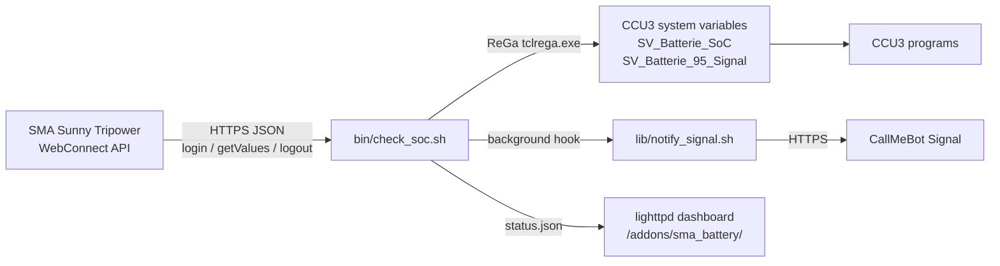

# Sentinella


Sentinella queries an SMA Sunny Tripower or Sunny Boy Storage inverter every two minutes over its local WebConnect API, updates two HomeMatic CCU3 / RaspberryMatic system variables (`SV_Batterie_SoC` and `SV_Batterie_95_Signal`), and optionally sends a Signal alert via CallMeBot when the configured thresholds are crossed.

## Overview

- Runs directly on a stock CCU3 or RaspberryMatic using `/bin/sh`, BusyBox `ash`, `curl`, `sed`, and `lighttpd`.
- No Python, Node.js, build step, or external CDN on the CCU.
- About 275 KB installed under `/usr/local/`.
- Failed or out-of-range readings never overwrite the last valid SoC.




### How a poll works

1. `bin/check_soc.sh` loads `.env`, checks input values, and acquires a lock directory in `state/` (stale PIDs are cleared).
2. It logs into the inverter (`POST /dyn/login.json`), reads the battery SoC (`6100_00295A00`) and optional charge/discharge power channels, and logs out (`POST /dyn/logout.json`).
3. If the reading is not an integer between `0` and `100`, the run exits with `1` and leaves the CCU3 variables untouched.
4. `SV_Batterie_95_Signal` turns `true` at `THRESHOLD_TRIGGER` (default `95%`), turns `false` at `THRESHOLD_RESET` (default `90%`), and keeps its previous state in between.
5. Both variables are written in a single `tclrega.exe` call, `status.json` is updated atomically, and on a threshold transition `lib/notify_signal.sh` runs detached in the background.


## Requirements

- **CCU3 / RaspberryMatic**: ReGaHSS on port `8181`, root SSH access, and ~275 KB free under `/usr/local/`.
- **SMA inverter**: HTTPS WebConnect reachable from the CCU3, read-capable WebUI password (`usr` or `user`), and battery channel `6100_00295A00` (see [docs/PROTOCOL.md](docs/PROTOCOL.md) if your firmware uses a different key).
- **Workstation** (for `deploy.sh` and tests): `bash`, `ssh`, `tar`, `curl`, `openssl`, Python 3.8+.

## Installation

### Quick deploy

```sh
git clone https://github.com/czett/sentinella.git
cd sentinella
cp .env.example .env
chmod 600 .env
${EDITOR:-vi} .env
```

Set at least `SMA_IP` and `SMA_PASS` in `.env`, then deploy to the CCU3:

```sh
./deploy.sh -H 192.168.178.10
```

`deploy.sh` copies the add-on to `/usr/local/addons/sma_battery`, links the web UI under `/usr/local/etc/config/addons/www/sma_battery/`, sets file permissions (`600` on `.env`, `755` on scripts and CGI endpoints), registers the two-minute cron job, creates `SV_Batterie_SoC` and `SV_Batterie_95_Signal`, and runs an initial check. Existing remote `.env` files and crontab lines are preserved.

Options:

```sh
./deploy.sh --dry-run                  # print actions without changing anything
./deploy.sh -H ccu3.local --skip-vars  # skip system variable creation
./deploy.sh -H ccu3.local --skip-cron  # skip crontab installation
```

### Manual installation

```sh
# 1. Copy files to the CCU3
ssh root@ccu3 "mkdir -p /usr/local/addons/sma_battery/state /usr/local/etc/config/addons/www/sma_battery/api"
tar -cf - -C . bin lib web setup_variables.sh .env \
  | ssh root@ccu3 "tar -xf - -C /usr/local/addons/sma_battery"

# 2. Permissions, web files, variables, and cron on the CCU3
ssh root@ccu3 '
  cd /usr/local/addons/sma_battery &&
  chown -R root:root . &&
  chmod 755 bin/check_soc.sh lib/notify_signal.sh setup_variables.sh &&
  chmod 600 .env &&
  cp web/index.html web/style.css web/app.js /usr/local/etc/config/addons/www/sma_battery/ &&
  cp web/api/config.cgi web/api/test_signal.cgi /usr/local/etc/config/addons/www/sma_battery/api/ &&
  chmod 755 /usr/local/etc/config/addons/www/sma_battery/api/*.cgi &&
  printf "%s\n" /usr/local/addons/sma_battery > /usr/local/etc/config/addons/www/sma_battery/api/addon_dir &&
  sh setup_variables.sh
'
```

Add the cron entry (`crontab -e`, see [`examples/crontab.txt`](examples/crontab.txt)):

```
*/2 * * * * /usr/local/addons/sma_battery/bin/check_soc.sh >/dev/null 2>&1
```

## Dashboard & Settings UI

Open `http://<ccu-address>/addons/sma_battery/` (`?demo=1` loads preview data when testing locally).

The dashboard refreshes `status.json` every 30 seconds and includes:

- **EN / DE** language switch (persisted to `.env` via `api/config.cgi` so Signal alerts match the UI language).
- **Light / Dark** theme toggle (Light is the default; selection is stored in `localStorage`).
- **Settings drawer** for thresholds, Signal notifications, CallMeBot onboarding message quick-paste extraction, and inverter credentials. Saving rewrites `.env` atomically (`chmod 600`) without exposing stored passwords or API keys to the browser.


`status.json` schema:

```json
{
  "schema": 1,
  "ui_language": "en",
  "generated_at": "2026-11-06T16:30:00Z",
  "generated_epoch": 1762446600,
  "host": "192.168.178.123",
  "soc": 91,
  "previous_soc": 92,
  "delta": -1,
  "charging": "discharging",
  "charge_power_w": 0,
  "discharge_power_w": 620,
  "signal": true,
  "signal_state": "held",
  "signal_notifications": true,
  "thresholds": { "trigger": 95, "reset": 90 },
  "variables": { "soc": "SV_Batterie_SoC", "signal": "SV_Batterie_95_Signal" },
  "ccu_status": "ok",
  "history": [{ "t": 1762446600, "soc": 91 }]
}
```

## Switching Logic


```
SoC
100 ┤
 95 ┤──────────── trigger ────────────  → true
 92 ┤            kept                     (previous state unchanged)
 90 ┤──────────── reset ──────────────  → false
  0 ┤
```

- If `state/signal` is missing and the first reading lands between `THRESHOLD_RESET` and `THRESHOLD_TRIGGER`, `SV_Batterie_95_Signal` is left untouched until a threshold is crossed.

| Condition | `SV_Batterie_SoC` | `SV_Batterie_95_Signal` | Exit code |
|---|---|---|---|
| Valid `0..100` | updated | updated or kept | `0` |
| `null`, missing, or out of range | unchanged | unchanged | `1` |
| Inverter or ReGaHSS HTTP error | unchanged | unchanged | `1` |
| Another poll still running | unchanged | unchanged | `0` |

## Configuration (`.env`)

### Inverter

| Key | Default | Description |
|---|---|---|
| `SMA_IP` | — | Inverter IPv4 address or hostname |
| `SMA_PORT` | `443` | HTTPS port |
| `SMA_ROLE` | `usr` | Login role (`usr` or `user`) |
| `SMA_PASS` | — | Inverter WebUI password |
| `BATTERY_SOC_KEY` | `6100_00295A00` | Battery SoC channel key |
| `BATTERY_CHARGE_POWER_KEY` | `6100_00417800` | Charge power key (empty disables) |
| `BATTERY_DISCHARGE_POWER_KEY` | `6100_00417900` | Discharge power key (empty disables) |
| `SMA_TLS_VERIFY` | `false` | Verify inverter TLS certificate (`false` passes `curl -k`) |
| `SMA_CONNECT_TIMEOUT` | `5` | TCP connect timeout (s) |
| `SMA_MAX_TIME` | `15` | Total request timeout (s) |
| `SMA_RETRIES` | `2` | Login/read/logout attempts |
| `SMA_RETRY_DELAY` | `5` | Delay between retries (s) |

### CCU3 & Thresholds

| Key | Default | Description |
|---|---|---|
| `CCU_IP` | `127.0.0.1` | CCU3 address |
| `CCU_REGA_PORT` | `8181` | ReGaHSS HTTP port |
| `SV_SOC_NAME` | `SV_Batterie_SoC` | Numeric system variable (`0..100 %`) |
| `SV_SIGNAL_NAME` | `SV_Batterie_95_Signal` | Boolean system variable |
| `THRESHOLD_TRIGGER` | `95` | Turn signal `true` at or above this SoC |
| `THRESHOLD_RESET` | `90` | Turn signal `false` at or below this SoC |
| `UI_LANGUAGE` | `en` | `en` or `de` for UI and default Signal texts |

### Signal Notifications

#### CallMeBot setup

Sentinella uses the [CallMeBot Signal API](https://www.callmebot.com/blog/free-api-signal-send-messages/) to deliver alerts. Activation takes two steps:

1. Send `I allow callmebot to send me messages` to CallMeBot on Signal. The bot replies with your credentials.
2. Copy the entire reply into the **Quick Setup** textarea in Sentinella's Settings drawer and click **Extract & Apply**.

Sentinella parses the Signal Account UUID (or phone number) and the API key from that text and fills both fields automatically, so nothing has to be retyped. The values are written to `SIGNAL_PHONE` and `SIGNAL_APIKEY` when the settings are saved.

#### Configuration

| Key | Default | Description |
|---|---|---|
| `SIGNAL_ENABLED` | `false` | Enable Signal alerts via CallMeBot |
| `SIGNAL_PHONE` | — | Phone number (auto-normalized to E.164, e.g. `+491711234567`) or Signal UUID |
| `SIGNAL_APIKEY` | — | CallMeBot API key |
| `SIGNAL_API_URL` | CallMeBot URL | Gateway endpoint |
| `SIGNAL_MESSAGE_OVERFLOW` | built-in | Optional custom trigger message (`{SOC}`, `{TRIGGER_SOC}`, `{RESET_SOC}`) |
| `SIGNAL_MESSAGE_RESET` | built-in | Optional custom reset message |
| `SIGNAL_MESSAGE_TEST` | built-in | Optional custom `--test` message |
| `SIGNAL_NOTIFY_ON_START` | `false` | Send alert on first run if already above trigger |
| `SIGNAL_TIMEOUT` | `15` | Request timeout (s) |
| `SIGNAL_RETRIES` | `2` | Delivery attempts |
| `SIGNAL_COOLDOWN` | `3600` | Minimum seconds between identical events |

Built-in messages:

| Event | English (`UI_LANGUAGE="en"`) | German (`UI_LANGUAGE="de"`) |
|---|---|---|
| Trigger | `Sentinella: Battery reached {SOC}% (Trigger: {TRIGGER_SOC}%). Excess energy available.` | `Sentinella: Batteriespeicher bei {SOC}% (Schwelle: {TRIGGER_SOC}%). Überschuss verfügbar.` |
| Reset | `Sentinella: Battery dropped below {RESET_SOC}% ({SOC}%). Overflow mode inactive.` | `Sentinella: Batteriespeicher unter {RESET_SOC}% gefallen ({SOC}%). Normalbetrieb aktiv.` |
| Test | `Sentinella: Connection verified. Telemetry and alert channel ready.` | `Sentinella: Verbindung erfolgreich getestet. Alarmsystem bereit.` |


Test Signal delivery from the shell without altering battery state:

```sh
/usr/local/addons/sma_battery/lib/notify_signal.sh --test; echo "exit=$?"
```

### Web & Logging

| Key | Default | Description |
|---|---|---|
| `WEB_ENABLED` | `true` | Copy `status.json` to lighttpd directory |
| `WEB_STATUS_FILE` | `/usr/local/etc/config/addons/www/sma_battery/status.json` | Public status path |
| `WEB_HISTORY_POINTS` | `288` | Chart samples kept (~9.6 h at 2-minute intervals) |
| `LOG_FILE` | `<addon>/state/check_soc.log` | Log file path (empty logs to syslog only) |
| `LOG_MAX_BYTES` | `262144` | Log rotation threshold in bytes |

## SMA WebConnect Quick Reference

Full protocol notes are in [docs/PROTOCOL.md](docs/PROTOCOL.md).

```sh
# 1. Login -> session ID (sid)
curl -k -sS -X POST -H 'Content-Type: application/json' \
  --data '{"right":"usr","pass":"secret"}' \
  https://192.168.178.123/dyn/login.json

# 2. Read battery SoC
curl -k -sS -X POST -H 'Content-Type: application/json' \
  --data '{"destDev":[],"keys":["6100_00295A00"],"sid":"<sid>"}' \
  'https://192.168.178.123/dyn/getValues.json?sid=<sid>'

# 3. Logout
curl -k -sS -X POST -H 'Content-Type: application/json' \
  --data '{"destDev":[],"sid":"<sid>"}' \
  'https://192.168.178.123/dyn/logout.json?sid=<sid>'
```

## Troubleshooting

See [docs/TROUBLESHOOTING.md](docs/TROUBLESHOOTING.md) for details. Quick diagnostics on the CCU3:

```sh
/usr/local/addons/sma_battery/bin/check_soc.sh; echo "exit=$?"
tail -n 50 /usr/local/addons/sma_battery/state/check_soc.log
logread | grep sma_battery
curl -sS -o /dev/null -w '%{http_code}\n' http://127.0.0.1:8181/tclrega.exe
```

| Symptom | Cause / Fix |
|---|---|
| `login failed` / `err 401` | Check `SMA_PASS`, `SMA_ROLE`, and whether the inverter WebUI account is locked. |
| Repeated `getValues` errors | Concurrent session limit reached on the inverter; close browser WebUI sessions and check for duplicate cron lines. |
| `no numeric value` | Battery offline or firmware uses a different channel key; see [docs/PROTOCOL.md](docs/PROTOCOL.md). |
| `CCU3 ReGa request failed` | ReGaHSS not reachable on `CCU_REGA_PORT` (`8181`), or variables missing (`sh setup_variables.sh`). |
| No Signal message | Run `lib/notify_signal.sh --test`; verify `SIGNAL_PHONE` and `SIGNAL_APIKEY`. |

## Tests & Development

```sh
sh -n bin/check_soc.sh lib/notify_signal.sh web/api/config.cgi setup_variables.sh
shellcheck -s sh -S style bin/check_soc.sh lib/notify_signal.sh web/api/config.cgi setup_variables.sh
shellcheck -s bash -S style deploy.sh
node --check web/app.js
python3 tests/integration.py
```

Optional workstation multicast sniffer for SMA Speedwire (`239.12.255.254:9524`):

```sh
python3 tools/speedwire_sniffer.py --interface 192.168.178.10 --count 5
```

## License

MIT — see [LICENSE](LICENSE).
