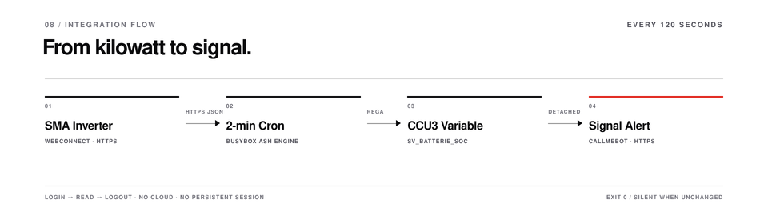
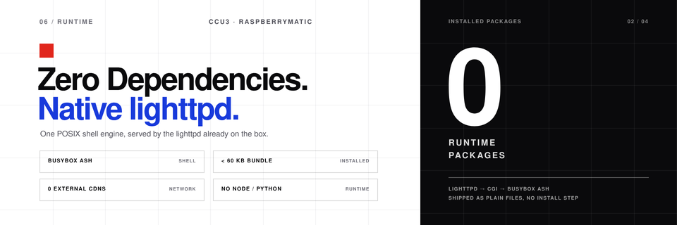
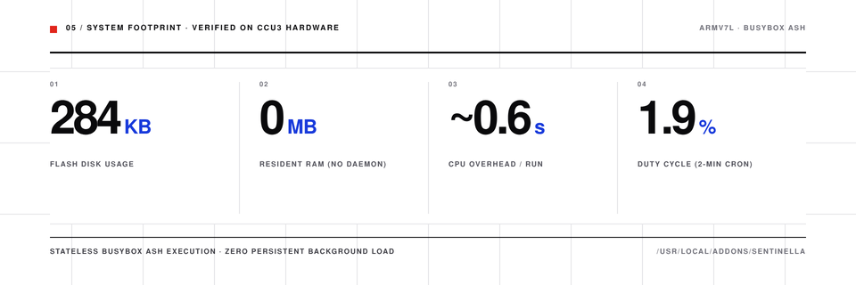
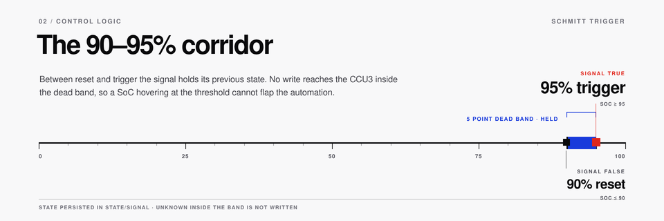

# Sentinella


Sentinella queries an SMA Sunny Tripower or Sunny Boy Storage inverter every two minutes over its local WebConnect API, updates two HomeMatic CCU3 / RaspberryMatic system variables (`SV_Batterie_SoC` and `SV_Batterie_95_Signal`), and optionally sends a Signal alert via CallMeBot when the configured thresholds are crossed.

## Feature Highlights

- **Modulares Plugin-System** — Standalone POSIX shell scripts in `plugins.d/` publish standardized JSON telemetry into a dynamic dashboard grid. No Python, Node.js, or build step on the CCU.
- **Integrated extensions** — `forecast.solar` (daily solar yield, zero API key) and Renault Zoe (MY Renault Gigya/Kamereon API with battery SoC, range, and charge state; token cache with automatic refresh).
- **Swiss-Poster Design System** — Pure CSS dark/light theme with monospace hero figures and a strict typographic grid. Zero UI libraries, no external CDN.

## Architecture

- Runs directly on a stock CCU3 or RaspberryMatic using `/bin/sh`, BusyBox `ash`, `curl`, `sed`, and `lighttpd`.
- No Python, Node.js, build step, or external CDN on the CCU.
- Failed or out-of-range readings never overwrite the last valid SoC.



### How a poll works

1. `bin/check_soc.sh` loads `.env`, checks input values, and acquires a lock directory in `state/` (stale PIDs are cleared).
2. It logs into the inverter (`POST /dyn/login.json`), reads the battery SoC (`6100_00295A00`) and optional charge/discharge power channels, and logs out (`POST /dyn/logout.json`).
3. If the reading is not an integer between `0` and `100`, the run exits with `1` and leaves the CCU3 variables untouched.
4. `SV_Batterie_95_Signal` turns `true` at `THRESHOLD_TRIGGER` (default `95%`), turns `false` at `THRESHOLD_RESET` (default `90%`), and keeps its previous state in between.
5. Both variables are written in a single `tclrega.exe` call, `status.json` is updated atomically, and on a threshold transition `lib/notify_signal.sh` runs detached in the background.



### System Footprint



- **Storage:** ~284 KB on `/usr/local/addons/sentinella/`
- **Resident RAM:** 0 MB (stateless, on-demand execution via BusyBox crontab)
- **CPU Overhead:** ~0.59s per cycle (0.43s user, 0.16s sys)
- **Duty Cycle:** Active ~1.9% of the time, dormant for 98.1%

### Plugin contract

Plugins are independent executables: read optional config, run once, write one JSON card atomically. The WebUI never calls plugin code.

```
/usr/local/addons/sentinella/
├── plugins.d/         # Executable plugin scripts (chmod 755)
├── config/plugins/    # Per-plugin env configs (mode 600)
└── state/plugins/     # JSON telemetry ingested by webui
```

`web/api/plugins.cgi` concatenates `state/plugins/*.json` into one array; `web/app.js` renders each file as a card in dashboard section **05 Extensions**. A card appears on the next 30-second refresh.

Every card shares `id`, `layout`, `title`, `status_badge`, `status_color` (`green`, `blue`, `red`, or `neutral`), and `timestamp`. Three layouts are available:

| Layout | Fields | Typical use |
|---|---|---|
| `stat` | `primary: {value, unit, label}`, `secondary_metrics[]` | SoC, power, temperatures |
| `delta` | `primary`, `delta: {direction, value, comparison}`, `secondary_metrics[]` | Forecasts, pricing, trends |
| `list` | `secondary_metrics[]` | Wallbox phases, charger status |

## Requirements

- **CCU3 / RaspberryMatic**: ReGaHSS on port `8181`, root SSH access, and ~284 KB free under `/usr/local/`.
- **SMA inverter**: HTTPS WebConnect reachable from the CCU3, read-capable WebUI password (`usr` or `user`), and battery channel `6100_00295A00` (see [docs/PROTOCOL.md](docs/PROTOCOL.md) if your firmware uses a different key).
- **Workstation** (for `deploy.sh` and tests): `bash`, `ssh`, `tar`, `curl`, `openssl`, Python 3.8+.

## Installation

### Quick deploy

```sh
git clone https://github.com/czett/sentinella.git
cd sentinella
cp .env.example .env
chmod 600 .env
${EDITOR:-vi} .env
```

Set at least `SMA_IP` and `SMA_PASS` in `.env`, then deploy to the CCU3:

```sh
./deploy.sh -H 192.168.178.10
```

`deploy.sh` copies the add-on to `/usr/local/addons/sentinella`, installs the web UI under `/usr/local/etc/config/addons/www/sentinella/` (and links `/addons/sma_battery/` + `/usr/local/addons/sma_battery` for backwards compatibility), sets file permissions (`600` on `.env`, `755` on scripts and CGI endpoints), registers the two-minute cron job, creates `SV_Batterie_SoC` and `SV_Batterie_95_Signal`, and runs an initial check. Existing remote `.env` files and crontab lines are preserved.

Options:

```sh
./deploy.sh --dry-run                  # print actions without changing anything
./deploy.sh -H ccu3.local --skip-vars  # skip system variable creation
./deploy.sh -H ccu3.local --skip-cron  # skip crontab installation
```

### Manual installation

```sh
# 1. Copy files to the CCU3
ssh root@ccu3 "mkdir -p /usr/local/addons/sentinella/state /usr/local/etc/config/addons/www/sentinella/api"
tar -cf - -C . bin lib web setup_variables.sh .env \
  | ssh root@ccu3 "tar -xf - -C /usr/local/addons/sentinella"

# 2. Permissions, web files, symlinks, variables, and cron on the CCU3
ssh root@ccu3 '
  cd /usr/local/addons/sentinella &&
  chown -R root:root . &&
  chmod 755 bin/check_soc.sh lib/notify_signal.sh setup_variables.sh &&
  chmod 600 .env &&
  cp web/index.html web/style.css web/app.js /usr/local/etc/config/addons/www/sentinella/ &&
  cp web/api/config.cgi web/api/test_signal.cgi /usr/local/etc/config/addons/www/sentinella/api/ &&
  chmod 755 /usr/local/etc/config/addons/www/sentinella/api/*.cgi &&
  printf "%s\n" /usr/local/addons/sentinella > /usr/local/etc/config/addons/www/sentinella/api/addon_dir &&
  ln -sfn /usr/local/addons/sentinella /usr/local/addons/sma_battery &&
  ln -sfn /usr/local/etc/config/addons/www/sentinella /usr/local/etc/config/addons/www/sma_battery &&
  [ -d /www/addons ] && ln -sfn /usr/local/addons/sentinella /www/addons/sentinella &&
  [ -d /www/addons ] && ln -sfn /usr/local/addons/sentinella /www/addons/sma_battery &&
  sh setup_variables.sh
'
```

Add the cron entry (`crontab -e`, see [`examples/crontab.txt`](examples/crontab.txt)):

```
*/2 * * * * /usr/local/addons/sentinella/bin/check_soc.sh >/dev/null 2>&1
```

## Dashboard & Settings UI

Open `http://<ccu-ip>/addons/sentinella/` (`?demo=1` loads preview data when testing locally).

The Web UI is a zero-dependency Swiss-style dashboard served directly by the CCU3's native `lighttpd`. It refreshes `status.json` every 30 seconds and provides live SoC telemetry, hysteresis switch status, a manual dark mode toggle (light default), an **EN / DE** language toggle (persisted to `.env` via `api/config.cgi`), a settings drawer for thresholds, CallMeBot Signal onboarding, inverter credentials, and Renault Zoe access, and a dynamic plugin grid in section **05 Extensions**.

`status.json` schema:

```json
{
  "schema": 1,
  "ui_language": "en",
  "generated_at": "2026-11-06T16:30:00Z",
  "generated_epoch": 1762446600,
  "host": "192.168.178.123",
  "soc": 91,
  "previous_soc": 92,
  "delta": -1,
  "charging": "discharging",
  "charge_power_w": 0,
  "discharge_power_w": 620,
  "signal": true,
  "signal_state": "held",
  "signal_notifications": true,
  "thresholds": { "trigger": 95, "reset": 90 },
  "variables": { "soc": "SV_Batterie_SoC", "signal": "SV_Batterie_95_Signal" },
  "ccu_status": "ok",
  "history": [{ "t": 1762446600, "soc": 91 }]
}
```

## Switching Logic



```
SoC
100 ┤
 95 ┤──────────── trigger ────────────  → true
 92 ┤            kept                     (previous state unchanged)
 90 ┤──────────── reset ──────────────  → false
  0 ┤
```

- If `state/signal` is missing and the first reading lands between `THRESHOLD_RESET` and `THRESHOLD_TRIGGER`, `SV_Batterie_95_Signal` is left untouched until a threshold is crossed.

| Condition | `SV_Batterie_SoC` | `SV_Batterie_95_Signal` | Exit code |
|---|---|---|---|
| Valid `0..100` | updated | updated or kept | `0` |
| `null`, missing, or out of range | unchanged | unchanged | `1` |
| Inverter or ReGaHSS HTTP error | unchanged | unchanged | `1` |
| Another poll still running | unchanged | unchanged | `0` |

## Configuration (`.env`)

### Inverter

| Key | Default | Description |
|---|---|---|
| `SMA_IP` | — | Inverter IPv4 address or hostname |
| `SMA_PORT` | `443` | HTTPS port |
| `SMA_ROLE` | `usr` | Login role (`usr` or `user`) |
| `SMA_PASS` | — | Inverter WebUI password |
| `BATTERY_SOC_KEY` | `6100_00295A00` | Battery SoC channel key |
| `BATTERY_CHARGE_POWER_KEY` | `6100_00417800` | Charge power key (empty disables) |
| `BATTERY_DISCHARGE_POWER_KEY` | `6100_00417900` | Discharge power key (empty disables) |
| `SMA_TLS_VERIFY` | `false` | Verify inverter TLS certificate (`false` passes `curl -k`) |
| `SMA_CONNECT_TIMEOUT` | `5` | TCP connect timeout (s) |
| `SMA_MAX_TIME` | `15` | Total request timeout (s) |
| `SMA_RETRIES` | `2` | Login/read/logout attempts |
| `SMA_RETRY_DELAY` | `5` | Delay between retries (s) |

### CCU3 & Thresholds

| Key | Default | Description |
|---|---|---|
| `CCU_IP` | `127.0.0.1` | CCU3 address |
| `CCU_REGA_PORT` | `8181` | ReGaHSS HTTP port |
| `SV_SOC_NAME` | `SV_Batterie_SoC` | Numeric system variable (`0..100 %`) |
| `SV_SIGNAL_NAME` | `SV_Batterie_95_Signal` | Boolean system variable |
| `THRESHOLD_TRIGGER` | `95` | Turn signal `true` at or above this SoC |
| `THRESHOLD_RESET` | `90` | Turn signal `false` at or below this SoC |
| `UI_LANGUAGE` | `en` | `en` or `de` for UI and default Signal texts |

### Signal Notifications

#### CallMeBot setup

Sentinella uses the [CallMeBot Signal API](https://www.callmebot.com/blog/free-api-signal-send-messages/) to deliver alerts. Activation takes two steps:

1. Send `I allow callmebot to send me messages` to CallMeBot on Signal. The bot replies with your credentials.
2. Copy the entire reply into the **CallMeBot Onboarding Message** textarea in Sentinella's Settings drawer (or click **Extract & Apply**).

Sentinella parses the Signal Account UUID and the API key from that text and populates both fields automatically. When saved, the values are written to `SIGNAL_PHONE` and `SIGNAL_APIKEY` in `.env`.

#### Configuration

| Key | Default | Description |
|---|---|---|
| `SIGNAL_ENABLED` | `false` | Enable Signal alerts via CallMeBot |
| `SIGNAL_PHONE` | — | Signal Account UUID (e.g. `98526357-0cec-4e7f-9d60-d854432414d3`) |
| `SIGNAL_APIKEY` | — | CallMeBot API key |
| `SIGNAL_API_URL` | CallMeBot URL | Gateway endpoint |
| `SIGNAL_MESSAGE_OVERFLOW` | built-in | Optional custom trigger message (`{SOC}`, `{TRIGGER_SOC}`, `{RESET_SOC}`) |
| `SIGNAL_MESSAGE_RESET` | built-in | Optional custom reset message |
| `SIGNAL_MESSAGE_TEST` | built-in | Optional custom `--test` message |
| `SIGNAL_NOTIFY_ON_START` | `false` | Send alert on first run if already above trigger |
| `SIGNAL_TIMEOUT` | `15` | Request timeout (s) |
| `SIGNAL_RETRIES` | `2` | Delivery attempts |
| `SIGNAL_COOLDOWN` | `3600` | Minimum seconds between identical events |

Test Signal delivery from the shell without altering battery state:

```sh
/usr/local/addons/sentinella/lib/notify_signal.sh --test; echo "exit=$?"
```

### Web & Logging

| Key | Default | Description |
|---|---|---|
| `WEB_ENABLED` | `true` | Copy `status.json` to lighttpd directory |
| `WEB_STATUS_FILE` | `/usr/local/etc/config/addons/www/sentinella/status.json` | Public status path |
| `WEB_HISTORY_POINTS` | `288` | Chart samples kept (~9.6 h at 2-minute intervals) |
| `LOG_FILE` | `/usr/local/addons/sentinella/state/check_soc.log` | Log file path (empty logs to syslog only) |
| `LOG_MAX_BYTES` | `262144` | Log rotation threshold in bytes |

## Plugin Configuration

Plugins are optional. Unconfigured plugins exit `0` before any network request, so they produce no log line and no dashboard card. Configuration is read from `config/plugins/<name>.env`; the WebUI Settings drawer writes the same files.

### Renault Zoe

Set `RENAULT_USER`, `RENAULT_PASS`, and `RENAULT_VIN` in the Settings drawer under **RENAULT ZOE**, or copy `config/plugins/renault.env.example` to `config/plugins/renault.env` and set mode `600`. The plugin caches the Gigya `id_token` and Kamereon `accountId` in `state/plugins/.renault_session` for 6 hours and refreshes them automatically on `401`/`403`.

```sh
/usr/local/addons/sentinella/plugins.d/20_renault_zoe.sh --test; echo "exit=$?"
```

### forecast.solar

No API key is required. The plugin works with built-in defaults; override latitude, longitude, roof geometry, and peak power in `config/plugins/forecast_solar.env` (see the `.example` file).

## SMA WebConnect Quick Reference

Full protocol notes are in [docs/PROTOCOL.md](docs/PROTOCOL.md).

```sh
# 1. Login -> session ID (sid)
curl -k -sS -X POST -H 'Content-Type: application/json' \
  --data '{"right":"usr","pass":"secret"}' \
  https://192.168.178.123/dyn/login.json

# 2. Read battery SoC
curl -k -sS -X POST -H 'Content-Type: application/json' \
  --data '{"destDev":[],"keys":["6100_00295A00"],"sid":"<sid>"}' \
  'https://192.168.178.123/dyn/getValues.json?sid=<sid>'

# 3. Logout
curl -k -sS -X POST -H 'Content-Type: application/json' \
  --data '{"destDev":[],"sid":"<sid>"}' \
  'https://192.168.178.123/dyn/logout.json?sid=<sid>'
```

## Troubleshooting

See [docs/TROUBLESHOOTING.md](docs/TROUBLESHOOTING.md) for details. Quick diagnostics on the CCU3:

```sh
/usr/local/addons/sentinella/bin/check_soc.sh; echo "exit=$?"
tail -n 50 /usr/local/addons/sentinella/state/check_soc.log
logread | grep sentinella
curl -sS -o /dev/null -w '%{http_code}\n' http://127.0.0.1:8181/tclrega.exe
```

| Symptom | Cause / Fix |
|---|---|
| `login failed` / `err 401` | Check `SMA_PASS`, `SMA_ROLE`, and whether the inverter WebUI account is locked. |
| Repeated `getValues` errors | Concurrent session limit reached on the inverter; close browser WebUI sessions and check for duplicate cron lines. |
| `no numeric value` | Battery offline or firmware uses a different channel key; see [docs/PROTOCOL.md](docs/PROTOCOL.md). |
| `CCU3 ReGa request failed` | ReGaHSS not reachable on `CCU_REGA_PORT` (`8181`), or variables missing (`sh setup_variables.sh`). |
| No Signal message | Run `lib/notify_signal.sh --test`; verify `SIGNAL_PHONE` and `SIGNAL_APIKEY`. |

## Developer Quickstart: Eigenes Plugin schreiben

A plugin is a POSIX shell script with no arguments. Write one JSON object atomically to `state/plugins/<id>.json`; the dashboard picks it up without a restart.

```sh
#!/bin/sh
APP_DIR=$(cd "$(dirname "$0")/.." && pwd)
OUT="$APP_DIR/state/plugins/example.json"
mkdir -p "${OUT%/*}"
printf '%s\n' '{"id":"example","layout":"stat","title":"Example",' \
  '"status_badge":"OK","status_color":"green",' \
  '"primary":{"value":42,"unit":"W","label":"Leistung"}}' > "$OUT.tmp"
mv -f "$OUT.tmp" "$OUT"
```

Save as `plugins.d/40_example.sh`, run `chmod 755`, execute it once, and reload the dashboard. Use `delta` for trend badges, `list` for key-value rows, and keep non-secret defaults in `config/plugins/example.env` (mode `600` for credentials). A failing request should keep the existing card and exit `0`; reserve non-zero exits for `--test` runs.

## Tests & Development

```sh
sh -n bin/check_soc.sh lib/notify_signal.sh web/api/config.cgi setup_variables.sh
shellcheck -s sh -S style bin/check_soc.sh lib/notify_signal.sh web/api/config.cgi setup_variables.sh
shellcheck -s bash -S style deploy.sh
node --check web/app.js
python3 tests/integration.py
```

Optional workstation multicast sniffer for SMA Speedwire (`239.12.255.254:9524`):

```sh
python3 tools/speedwire_sniffer.py --interface 192.168.178.10 --count 5
```

## License

MIT — see [LICENSE](LICENSE).
