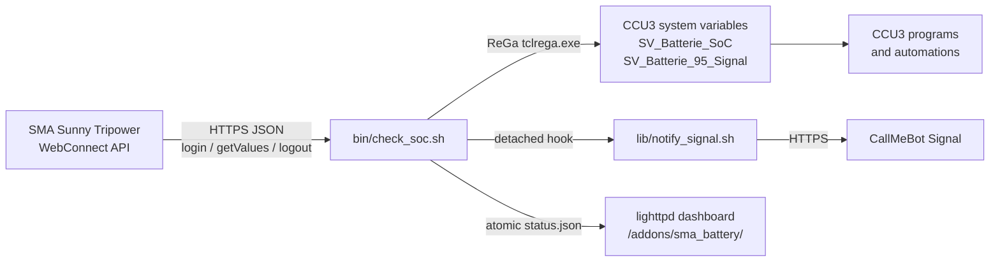

# Sentinella — High-Precision SMA Battery Monitor for CCU3

**Sentinella** is an independent, high-precision battery monitor for a **Homematic CCU3 / RaspberryMatic** and an **SMA Sunny Tripower / Sunny Boy Storage** with a BYD or similar battery. It reads the state of charge (SoC) from the inverter's local WebConnect JSON API, writes it to a CCU3 system variable, and drives a 95 % hysteresis signal for charging or automation programs.

The project is deliberately small: POSIX `/bin/sh`, BusyBox `ash`, `curl`, `sed` and nothing else. No Python, no Node.js, no build step on the CCU.

- **Reliable** - every SMA session is logged out, also on `SIGTERM`, and a lock directory prevents overlapping cron runs.
- **Safe** - a failed, missing or out-of-range SoC never overwrites the last good CCU3 value.
- **Configurable** - everything lives in one `.env` file with typed defaults and validation.
- **Observable** - structured `status.json` snapshot plus a self-contained Sentinella telemetry dashboard.
- **Documented** - English and German guides, protocol notes and a troubleshooting reference.

## Features

| | |
|---|---|
| Inverter read | SMA WebConnect JSON API over HTTPS, configurable channel key |
| CCU3 write | ReGaHSS `tclrega.exe`, no third-party CCU packages required |
| Hysteresis | trigger at `THRESHOLD_TRIGGER`, reset at `THRESHOLD_RESET`, state persisted |
| Fault handling | null, non-numeric, out-of-range or unreachable values keep the previous CCU3 state |
| Session safety | `EXIT`, `INT`, `TERM` and `HUP` traps always call `logout.json` |
| Concurrency | PID lock directory with stale-lock recovery |
| Notifications | optional detached CallMeBot Signal hook, never blocks cron |
| Dashboard | vanilla HTML/CSS/JS telemetry console: colour-block SoC hero, hysteresis rail, stark history chart |
| Web settings | thresholds, Signal phone/UUID, API key and inverter credentials editable in the browser |
| Deployment | `deploy.sh` over SSH, idempotent cron and system-variable setup |

## Architecture



```
+------------------+    HTTPS / JSON     +---------------------+    ReGa HTTP     +-----------------------+
| SMA inverter     | ------------------> | bin/check_soc.sh    | ---------------> | SV_Batterie_SoC       |
| WebConnect API   | <------------------ | lock, traps, retry  | <--------------- | SV_Batterie_95_Signal |
+------------------+                     +---------------------+                  +-----------------------+
                                                   |         |
                              detached notification |         | atomic write
                                                   v         v
                                        lib/notify_signal.sh  web/status.json (lighttpd)
                                                   |
                                                   v
                                        CallMeBot Signal API
```

### Runtime flow

1. `check_soc.sh` loads `.env` and validates every value.
2. A lock directory under `state/` is created. A live PID makes the new run exit quietly; a stale lock is removed.
3. The script logs in (`POST /dyn/login.json`), reads the SoC and optional power keys, and logs out (`POST /dyn/logout.json`). The whole cycle is retried up to `SMA_RETRIES` times.
4. The SoC is validated as an integer from 0 to 100. Invalid values stop the run and leave the CCU3 variables untouched.
5. Hysteresis is evaluated against the persisted state. Between the thresholds the previous state is held.
6. The CCU3 variables are written through ReGaHSS with one `tclrega.exe` request.
7. `state/status.json` is updated atomically and, if enabled, copied to the lighttpd directory as `status.json`.
8. On a state transition, `lib/notify_signal.sh` is started in the background. Cron never waits for the phone notification.

## Repository layout

```
.
├── .env.example              configuration template (copy to .env)
├── .gitignore                secrets, logs, state and build output
├── LICENSE                   MIT
├── CHANGELOG.md              release history
├── SECURITY.md               vulnerability reporting and secret handling
├── README.md                 this guide
├── README.de.md              German guide
├── CONTRIBUTING.md           development and pull-request rules
├── deploy.sh                 workstation deployment helper (bash)
├── setup_variables.sh        idempotent ReGa system-variable setup
├── bin/
│   └── check_soc.sh          core engine (POSIX sh, BusyBox ash)
├── lib/
│   └── notify_signal.sh      detached Signal notification hook
├── web/
│   ├── index.html            Sentinella telemetry markup and settings drawer
│   ├── style.css             paper/ultramarine palette, responsive, no external assets
│   ├── app.js                dashboard, chart and settings client
│   ├── api/
│   │   ├── config.cgi        settings API (GET/POST config)
│   │   └── test_signal.cgi   background test-notification endpoint
│   └── status.example.json   payload example / local preview
├── docs/
│   ├── PROTOCOL.md           SMA WebConnect reverse-engineering notes
│   └── TROUBLESHOOTING.md    extended fault guide
├── examples/
│   ├── crontab.txt           cron entry used by deploy.sh
│   └── setup_variables.rega  raw ReGa payload for the script editor
├── tests/
│   └── integration.py        mock SMA + ReGa integration tests
└── tools/
    └── speedwire_sniffer.py  optional multicast diagnostic helper
```

## Requirements

**CCU3 / RaspberryMatic**

- Current CCU3 or RaspberryMatic firmware with ReGaHSS on port `8181`.
- `curl`, `sed`, `tr`, `cut`, `head`, `tail`, `date`, `logger` (all part of the standard image).
- Root SSH access for installation.
- About 250 KB of persistent space under `/usr/local/`.

**SMA inverter**

- Reachable from the CCU3 over HTTPS.
- WebUI user with read access. The installer role `usr` is the default; `user` is also accepted.
- Battery visible in the inverter WebUI. The standard SoC key is `6100_00295A00`; some firmware versions expose different keys (see [docs/PROTOCOL.md](docs/PROTOCOL.md)).

**Workstation (only for `deploy.sh` and tests)**

- `bash`, `ssh`, `tar`, `curl`.
- Python 3.8+ and `openssl` for the integration tests.

## Installation

### 1. Get the code

```sh
git clone https://github.com/<your-account>/sentinella.git
cd sentinella
```

### 2. Configure

```sh
cp .env.example .env
chmod 600 .env
${EDITOR:-vi} .env
```

At minimum set:

| Key | Meaning |
|---|---|
| `SMA_IP` | inverter address, e.g. `192.168.178.123` |
| `SMA_PASS` | inverter WebUI password |
| `CCU_IP` | `127.0.0.1` when the monitor runs on the CCU3 |
| `DEPLOY_HOST` | CCU3 address used by `deploy.sh` |

Keep `.env` at mode `600`. It is already ignored by Git.

### 3. Deploy (recommended)

```sh
./deploy.sh -H 192.168.178.10
```

`deploy.sh` performs these steps idempotently:

1. Checks the SSH connection.
2. Streams `bin/`, `lib/`, `web/`, `setup_variables.sh` and `.env` to `/usr/local/addons/sma_battery` using `tar` over SSH (no remote `rsync` required).
3. Sets `700` on scripts and directories, `600` on `.env`, `644` on dashboard files and `755` on the CGI endpoints.
4. Copies the dashboard and the settings API to `/usr/local/etc/config/addons/www/sma_battery/` and probes the CGI endpoint through lighttpd.
5. Adds `*/2 * * * * /usr/local/addons/sma_battery/bin/check_soc.sh` to root's crontab and restarts `S71crond`.
6. Runs `setup_variables.sh` to create the two system variables.
7. Runs a first check and prints the dashboard URL.

Useful options:

```sh
./deploy.sh --dry-run                 # show the plan, change nothing
./deploy.sh -H ccu3.local --skip-vars # keep existing variables
./deploy.sh -H ccu3.local --skip-cron # manual scheduling
```

### 4. Manual installation

On the CCU3:

```sh
mkdir -p /usr/local/addons/sma_battery/state
mkdir -p /usr/local/etc/config/addons/www/sma_battery
```

From your workstation:

```sh
tar -cf - -C . bin lib web setup_variables.sh .env \
  | ssh root@ccu3 "tar -xf - -C /usr/local/addons/sma_battery"
```

On the CCU3:

```sh
cd /usr/local/addons/sma_battery
chmod 700 bin/check_soc.sh lib/notify_signal.sh setup_variables.sh
chmod 600 .env
mkdir -p /usr/local/etc/config/addons/www/sma_battery/api
cp web/index.html web/style.css web/app.js \
   /usr/local/etc/config/addons/www/sma_battery/
cp web/api/config.cgi web/api/test_signal.cgi \
   /usr/local/etc/config/addons/www/sma_battery/api/
chmod 755 /usr/local/etc/config/addons/www/sma_battery/api/*.cgi
printf '%s\n' /usr/local/addons/sma_battery \
   > /usr/local/etc/config/addons/www/sma_battery/api/addon_dir
```

### 5. Create the system variables

```sh
cd /usr/local/addons/sma_battery
sh setup_variables.sh
```

The script is idempotent and creates:

- `SV_Batterie_SoC` - number, `0..100`, unit `%`
- `SV_Batterie_95_Signal` - boolean

Both are registered under `ID_SYSTEM_VARIABLES`, so they appear in **Status and Control → System variables**. A raw copy for the CCU3 script editor is in [`examples/setup_variables.rega`](examples/setup_variables.rega).

### 6. Install the cron job

On the CCU3:

```sh
crontab -l 2>/dev/null | grep -v '/usr/local/addons/sma_battery/bin/check_soc.sh' > /tmp/sma.cron
echo '*/2 * * * * /usr/local/addons/sma_battery/bin/check_soc.sh >/dev/null 2>&1' >> /tmp/sma.cron
crontab /tmp/sma.cron
/etc/init.d/S71crond restart
```

Verify:

```sh
crontab -l
ps | grep crond
```

A complete copy is in [`examples/crontab.txt`](examples/crontab.txt). No `rc.local` entry is needed: the CCU3 starts `crond` at boot, and the root crontab is persistent under `/etc/crontabs/root`. If a firmware update resets the crontab, re-run `./deploy.sh`.

### 7. Open the dashboard

```
http://<ccu-address>/addons/sma_battery/
```

The first value appears after the next cron run (up to two minutes). The page refreshes every 30 seconds and shows a clear "Waiting for first measurement" notice when `status.json` does not exist yet. Add `?demo=1` to preview the layout with generated data, labelled "Sentinella Preview Data".

### 8. Settings in the browser

The settings button in the dashboard masthead opens the settings drawer. From there you can change, without touching `.env` or opening a terminal:

- trigger and reset SoC levels,
- the Signal on/off switch,
- the phone number or Signal UUID and the CallMeBot API key,
- the SMA inverter address, HTTPS port and WebUI password.

**Test notification** saves the current form first and then runs `lib/notify_signal.sh --test` in the background on the CCU. The drawer polls for the result and reports success or failure as a toast. A test never changes `state/signal` or the alert cooldown.

**Save configuration** writes the values atomically to `.env`: a private copy is edited and moved over the original with `mv`, so a cron run always reads either the complete old or the complete new file. When Signal is enabled, a successful save immediately starts the same background test, so a wrong phone/UUID or API key is reported right away instead of waiting for the battery to reach the trigger level. The form stays editable while the message is sent. The file stays `chmod 600`. Secrets are never sent back to the browser - the API returns only `signal_apikey_set` and `sma_password_set`, and an empty secret field means "keep the stored value".

The API is same-origin only and validates every value (SoC `0..100`, trigger above reset, E.164 phone or Signal UUID, host name, port range). It is served from `api/config.cgi` and `api/test_signal.cgi` under the dashboard URL. If your firmware does not execute `.cgi` files under `/addons/`, see [the CGI section in the troubleshooting guide](docs/TROUBLESHOOTING.md#settings-panel-and-cgi).

## Configuration reference

All keys live in `.env`. The file is sourced by `/bin/sh`; quote values, and prefer single quotes for secrets. After the initial deployment, the common settings can also be edited in the dashboard's settings drawer.

### Inverter

| Key | Type | Default | Description |
|---|---|---|---|
| `SMA_IP` | host | - | IPv4 address or DNS name, no scheme |
| `SMA_PORT` | int | `443` | HTTPS port of the inverter WebUI |
| `SMA_ROLE` | `usr`/`user` | `usr` | WebUI login role |
| `SMA_PASS` | secret | - | WebUI password |
| `BATTERY_SOC_KEY` | string | `6100_00295A00` | SoC channel key |
| `BATTERY_CHARGE_POWER_KEY` | string | `6100_00417800` | optional charging power key; empty disables |
| `BATTERY_DISCHARGE_POWER_KEY` | string | `6100_00417900` | optional discharging power key; empty disables |
| `SMA_TLS_VERIFY` | bool | `false` | verify the inverter certificate (`false` = `curl -k`) |
| `SMA_CONNECT_TIMEOUT` | int | `5` | TCP connect timeout in seconds |
| `SMA_MAX_TIME` | int | `15` | total request timeout in seconds |
| `SMA_RETRIES` | int | `2` | full login/read/logout cycles |
| `SMA_RETRY_DELAY` | int | `5` | seconds between attempts |

### CCU3

| Key | Type | Default | Description |
|---|---|---|---|
| `CCU_IP` | host | `127.0.0.1` | CCU address; localhost when running on the CCU |
| `CCU_REGA_PORT` | int | `8181` | ReGaHSS HTTP port |
| `SV_SOC_NAME` | identifier | `SV_Batterie_SoC` | number system variable |
| `SV_SIGNAL_NAME` | identifier | `SV_Batterie_95_Signal` | boolean system variable |
| `THRESHOLD_TRIGGER` | int 0..100 | `95` | set the signal true at or above this SoC |
| `THRESHOLD_RESET` | int 0..100 | `90` | set the signal false at or below this SoC |

`THRESHOLD_TRIGGER` must be greater than `THRESHOLD_RESET`. Both variable names must consist of letters, digits and underscores.

### Notifications

| Key | Type | Default | Description |
|---|---|---|---|
| `SIGNAL_ENABLED` | bool | `false` | enable CallMeBot Signal messages |
| `SIGNAL_PHONE` | string | - | E.164 number, including `+` |
| `SIGNAL_APIKEY` | secret | - | CallMeBot API key for that number |
| `SIGNAL_API_URL` | url | CallMeBot Signal endpoint | compatible gateway |
| `SIGNAL_MESSAGE_OVERFLOW` | string | see `.env.example` | overflow message; placeholders `{SOC}`, `{TRIGGER_SOC}`, `{RESET_SOC}`, `{HOST}` |
| `SIGNAL_MESSAGE_RESET` | string | see `.env.example` | recovery message; same placeholders |
| `SIGNAL_MESSAGE_TEST` | string | see `.env.example` | text sent by `notify_signal.sh --test` |
| `SIGNAL_NOTIFY_ON_START` | bool | `false` | notify on first run if the signal is already active |
| `SIGNAL_TIMEOUT` | int | `15` | notification request timeout |
| `SIGNAL_RETRIES` | int | `2` | notification attempts |
| `SIGNAL_COOLDOWN` | int | `3600` | suppress duplicate trigger/reset messages inside this many seconds |

Notifications are sent only on a hysteresis transition (`false → true` and `true → false`), after the CCU3 write succeeded. The hook is detached with `setsid`/`nohup` and never delays the cron job. A per-event cooldown prevents duplicate messages when cron runs every two minutes or a state file is lost. Message text is URL-encoded by `curl --data-urlencode`, so spaces, umlauts and `ß` work on BusyBox without python or jq. Legacy `SIGNAL_TEXT_TRIGGER`/`SIGNAL_TEXT_RESET` and `%SOC%`-style placeholders remain supported.

### Dashboard and logging

| Key | Type | Default | Description |
|---|---|---|---|
| `WEB_ENABLED` | bool | `true` | publish `status.json` |
| `WEB_STATUS_FILE` | path | `/usr/local/etc/config/addons/www/sma_battery/status.json` | lighttpd target |
| `WEB_HISTORY_POINTS` | int | `288` | samples kept for the chart (2 min × 288 ≈ 9.6 h) |
| `LOG_FILE` | path | `<addon>/state/check_soc.log` | local log; empty disables file logging |
| `LOG_MAX_BYTES` | int | `262144` | rotate once above this size |

### Deployment

| Key | Type | Default | Description |
|---|---|---|---|
| `DEPLOY_HOST` | host | - | CCU3 SSH host for `deploy.sh` |
| `DEPLOY_USER` | string | `root` | SSH user |
| `DEPLOY_PORT` | int | `22` | SSH port |
| `DEPLOY_ADDON_DIR` | path | `/usr/local/addons/sma_battery` | remote add-on directory |
| `DEPLOY_WEB_DIR` | path | `/usr/local/etc/config/addons/www/sma_battery` | remote dashboard directory |

## How the signal works

The boolean is a classic Schmitt trigger:

```
SoC
100 ┤
 95 ┤──────────── trigger ────────────  → true
 92 ┤            held                    (previous state unchanged)
 90 ┤──────────── reset ──────────────  → false
  0 ┤
```

- At or above `THRESHOLD_TRIGGER`, the signal becomes `true`.
- At or below `THRESHOLD_RESET`, it becomes `false`.
- Between the two, the value in `state/signal` is reused.
- If the state file is missing and the SoC is inside the dead band (for example 92 %), the boolean is deliberately **not written**. This avoids a premature reset after a fresh install or a lost state file. The status dashboard reports `signal: null` and `signal_state: "unknown"` for that run.

Fault behaviour is intentionally conservative:

| Condition | CCU3 SoC | CCU3 signal | Exit |
|---|---|---|---|
| valid 0..100 | written | written or held | 0 |
| `null` / missing value | unchanged | unchanged | 1 |
| non-integer / `101` / `-1` | unchanged | unchanged | 1 |
| login or `getValues` failure | unchanged | unchanged | 1 |
| ReGa request failure | unchanged | unchanged | 1 |
| another run is active | unchanged | unchanged | 0 |

## Dashboard

The Sentinella dashboard is a static single-page app with no external fonts, scripts or CDNs. It uses a warm paper ground, one full-bleed ultramarine SoC field, hairline rules and heavy Helvetica-set figures, with the Signal Red square as its only brand mark. It reads `status.json` with `fetch()` every 30 seconds and renders:

- an oversized state-of-charge figure on the ultramarine SoC field, with the charging state as a flat state tag,
- a hairline hysteresis rail with a square SoC marker and bold labels for the reset and trigger levels,
- a 2×2 telemetry grid for charging state, battery power, CCU write result and last sample time,
- a stark two-tone history chart from the samples kept by the monitor,
- a system register with the inverter host, variable names, Signal gateway and timestamp,
- mobile pull-to-refresh; there are no dot badges or age timers, freshness is conveyed by the values and by a plain notice strip when a poll fails.

`status.json` is written atomically and contains no secrets:

```json
{
  "schema": 1,
  "generated_at": "2026-11-06T16:30:00Z",
  "generated_epoch": 1762446600,
  "host": "192.168.178.123",
  "soc": 91,
  "previous_soc": 92,
  "delta": -1,
  "charging": "discharging",
  "charge_power_w": 0,
  "discharge_power_w": 620,
  "signal": true,
  "signal_state": "held",
  "signal_notifications": true,
  "thresholds": { "trigger": 95, "reset": 90 },
  "variables": { "soc": "SV_Batterie_SoC", "signal": "SV_Batterie_95_Signal" },
  "ccu_status": "ok",
  "history": [{ "t": 1762446600, "soc": 91 }]
}
```

For a local preview without a CCU3, copy `web/status.example.json` to `web/status.json` and serve the `web/` directory with any static server, or open the page with `?demo=1`. The "Sentinella Preview Data" notice makes it unmistakable that the values are not live.

If you do not want the dashboard, set `WEB_ENABLED="false"`. The monitor still writes a private snapshot to `<addon>/state/status.json`.

## SMA WebConnect notes

The complete notes, including key discovery and session limits, are in [docs/PROTOCOL.md](docs/PROTOCOL.md). The short version:

```sh
# 1. login -> sid
curl -k -sS -X POST -H 'Content-Type: application/json' \
  --data '{"right":"usr","pass":"secret"}' \
  https://192.168.178.123/dyn/login.json

# 2. read the battery SoC
curl -k -sS -X POST -H 'Content-Type: application/json' \
  --data '{"destDev":[],"keys":["6100_00295A00"],"sid":"<sid>"}' \
  'https://192.168.178.123/dyn/getValues.json?sid=<sid>'

# 3. always log out
curl -k -sS -X POST -H 'Content-Type: application/json' \
  --data '{"destDev":[],"sid":"<sid>"}' \
  'https://192.168.178.123/dyn/logout.json?sid=<sid>'
```

`6100_00295A00` is the standard battery SoC channel on Sunny Tripower / Sunny Boy Storage devices. The key can vary by firmware; see the protocol notes for discovery. The optional power keys `6100_00417800` and `6100_00417900` improve the charging/discharging display but are not required - the dashboard falls back to the SoC trend when they are absent.

## Signal notifications

1. Add the CallMeBot Signal bot to your phone and activate the API key as described by CallMeBot.
2. Put the phone number and API key into `.env`:

```sh
SIGNAL_ENABLED="true"
SIGNAL_PHONE="+491701234567"
SIGNAL_APIKEY="123456"
```

3. Re-run `./deploy.sh` or copy the updated `.env` and `chmod 600` it. Redeploying keeps the existing remote `.env`, so live credentials are not overwritten.
4. Validate credentials and end-to-end delivery without faking a battery event:

```sh
/usr/local/addons/sma_battery/lib/notify_signal.sh --test; echo "exit=$?"
```

`--test` sends a clearly marked test message and does not read or write `state/signal`. `deploy.sh` runs the same test automatically when `SIGNAL_ENABLED="true"` and `--skip-test` was not given.

The notifier writes to the same log and to syslog tag `sma_battery_notify`.

## Troubleshooting

The extended guide is [docs/TROUBLESHOOTING.md](docs/TROUBLESHOOTING.md). Quick checks:

```sh
# run once in the foreground
/usr/local/addons/sma_battery/bin/check_soc.sh; echo "exit=$?"

# recent log lines
tail -n 50 /usr/local/addons/sma_battery/state/check_soc.log
logread | grep sma_battery

# is cron alive?
ps | grep crond
crontab -l

# is ReGaHSS reachable?
curl -sS -o /dev/null -w '%{http_code}\n' http://127.0.0.1:8181/tclrega.exe
```

Common causes:

| Symptom | Likely cause |
|---|---|
| `login failed` / `err 401` | wrong password, wrong role, or the WebUI user is locked |
| repeated `getValues` failure | old session still open; wait a few minutes, check for duplicate cron jobs |
| `no numeric value` | battery not connected, wrong `BATTERY_SOC_KEY`, or firmware does not expose it |
| `CCU3 ReGa request failed` | ReGaHSS not running, wrong `CCU_REGA_PORT`, or CCU3 is overloaded |
| variables do not exist | run `setup_variables.sh`; names are case-sensitive |
| dashboard shows "Waiting for first measurement" | first cron run has not completed, or `WEB_STATUS_FILE` is outside the lighttpd directory |
| dashboard shows "Showing last recorded state" | the latest poll failed; check cron and the log |

### BusyBox and CCU3 caveats

- Use `#!/bin/sh`, not bash. No `local`, arrays, `[[ ]]`, process substitution, `set -u` assumptions or `date -d`.
- `curl` on the CCU3 may be older; the scripts stick to `-sS`, `-k`, `-m`, `--connect-timeout`, `--data-binary`, `--data-urlencode`.
- `/` is read-only on the CCU3. All persistent data belongs under `/usr/local/`.
- `cron` starts with a minimal environment. `check_soc.sh` sets its own `PATH`.
- Log out of the SMA WebUI sessions you open manually. The inverter allows only a small number of concurrent sessions and can temporarily refuse new logins.
- A lost `state/signal` file does not cause a reset inside the dead band; the monitor holds the boolean and logs `signal=unchanged`.

## Security

- `.env` contains the inverter password and the CallMeBot API key. It is ignored by Git, deployed with mode `600`, and warned about if the mode is wrong.
- The SMA certificate is self-signed by default, so `SMA_TLS_VERIFY="false"` is the working default. Set it to `"true"` only after installing a trusted certificate on the inverter.
- ReGaHSS is contacted over HTTP on the local CCU. Do not expose port `8181` to the internet.
- `status.json` contains only SoC, thresholds, variable names and host address. It contains no password, SID or API key.
- The lock directory and state files are mode `700`/`600`.
- The script logs in, reads and logs out in one run. It does not keep a session between cron invocations.

## Development and tests

```sh
# POSIX syntax
sh -n bin/check_soc.sh
sh -n lib/notify_signal.sh
sh -n setup_variables.sh

# ShellCheck (POSIX profile)
shellcheck -s sh -S style bin/check_soc.sh lib/notify_signal.sh setup_variables.sh

# Bash deployment helper
shellcheck -s bash -S style deploy.sh

# JavaScript syntax
node --check web/app.js

# End-to-end tests with mock SMA and ReGa servers
python3 tests/integration.py
```

The integration test starts a self-signed HTTPS SMA mock and an HTTP ReGa mock, then exercises successful reads, hysteresis transitions, the unknown-state hold, null/out-of-range values, login failure, the lock, `SIGTERM` logout, detached notifications and the ReGa setup payload.

See [CONTRIBUTING.md](CONTRIBUTING.md) for coding rules.

## Migrating from the old `sma_soc` add-on

The new layout replaces `config.env` with `.env`. If no `.env` exists, the engine still falls back to `config.env` for a transition period.

| Old key | New key |
|---|---|
| `SMA_HOST` | `SMA_IP` |
| `SMA_SOC_KEY` | `BATTERY_SOC_KEY` |
| `SMA_INSECURE="1"` | `SMA_TLS_VERIFY="false"` |
| `SMA_INSECURE="0"` | `SMA_TLS_VERIFY="true"` |
| `SV_SIGNAL_ON` | `THRESHOLD_TRIGGER` |
| `SV_SIGNAL_OFF` | `THRESHOLD_RESET` |
| `CCU_REGA_URL` | `CCU_IP` + `CCU_REGA_PORT` |
| `SV_SOC_NAME` | unchanged |
| `SV_SIGNAL_NAME` | unchanged |

The default install directory is now `/usr/local/addons/sma_battery`; adjust `deploy.sh --dir` if you want to keep the old path.

## Optional diagnostic tool

`tools/speedwire_sniffer.py` listens for SMA Speedwire multicast telegrams on `239.12.255.254:9524`. It is not needed for the monitor, but it helps verify that the inverter is on the network and shows whether battery-related vendor channels are present. It requires Python on the workstation, not on the CCU3.

```sh
python3 tools/speedwire_sniffer.py --interface 192.168.178.10 --count 5
```

## License

MIT - see [LICENSE](LICENSE).
