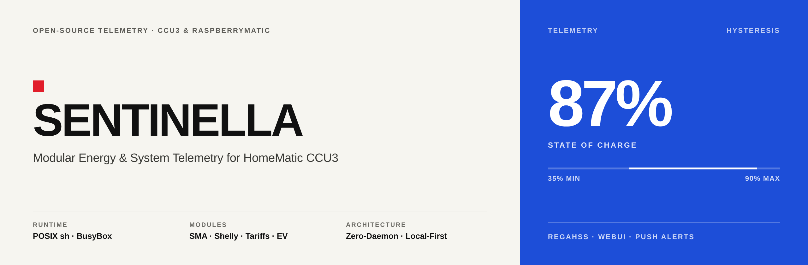
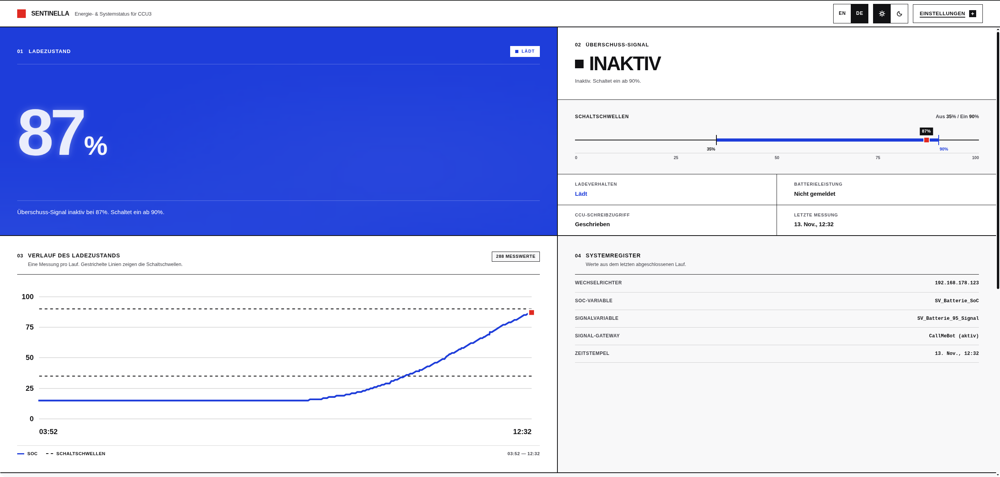
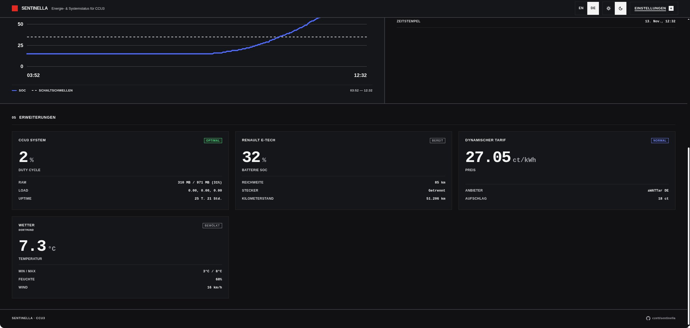
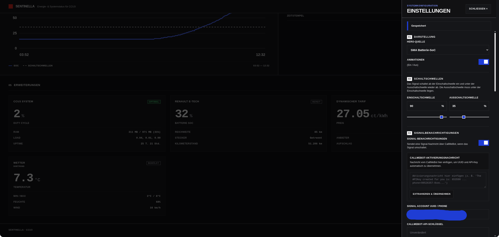
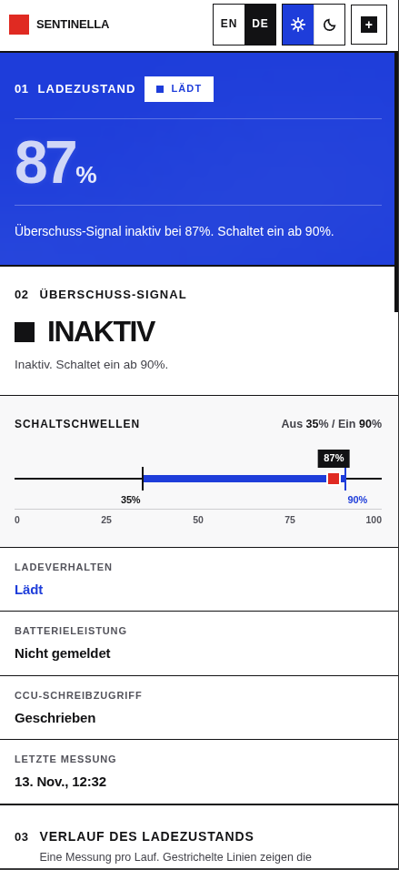

# Sentinella



**English** · [Deutsch](README.de.md)

**Sentinella: a low-footprint energy and system monitor for the HomeMatic CCU3.**

Sentinella is a POSIX-shell monitoring platform for CCU3 and RaspberryMatic. A single cron-driven engine collects telemetry from SMA storage, Shelly EM meters, Renault E-Tech vehicles, dynamic electricity tariffs, the CCU3 host, and Open-Meteo weather, then writes `status.json`, updates CCU3 system variables, and dispatches stateful push alerts. No daemon, Node.js, Python, `jq`, or external CDN runs on the CCU3.

## Capabilities

1. **SMA solar and home storage (optional)**: SoC, charge/discharge power, and the grid-surplus signal over HTTPS WebConnect. Omit `SMA_IP` or set `SMA_ENABLED=0` for CCU-Only Mode.
2. **CCU3 host telemetry**: duty cycle via XML-RPC on ports `2001`/`2010`, load average, RAM, uptime.
3. **Shelly EM grid telemetry**: real-time grid power, phase telemetry, and energy counters over local HTTP (Gen1 & Gen2/Pro).
4. **Dynamic electricity tariffs**: zero-config aWATTar (DE/AT) hourly prices or Tibber via API token.
5. **EV telemetry** (Renault E-Tech): SoC, range, plug status, charging state, odometer for Zoe, Megane, and R5.
6. **Weather and PV outlook**: keyless Open-Meteo weather and an optional experimental forecast.solar yield outlook.
7. **Stateful push alerts**: Signal / CallMeBot with hysteresis, per-event cooldowns, and first-run silence.
8. **Plugin manager & configurable Hero Tile**: WebUI toggles with instant auto-save; choose `auto`, `sma`, `ccu`, or `shelly` as the primary Hero Tile.

| Module | Default | Data | Source |
|---|---|---|---|
| **SMA storage** (core, optional) | active when `SMA_IP` is set | SoC, charge/discharge power, surplus signal | HTTPS WebConnect |
| **CCU3 Health** (`10_ccu_health.sh`) | enabled | Duty cycle, load average, RAM, uptime | `tclrpc.so` XML-RPC on `127.0.0.1:2001`, fallback `2010`; `/proc` |
| **Weather** (`15_weather.sh`) | enabled | Temperature, humidity, WMO condition, wind, daily min/max | Open-Meteo, no API key |
| **Renault E-Tech** (`20_renault_zoe.sh`) | disabled until configured | SoC, range, plug status, charging state, odometer | MY Renault cloud |
| **Shelly EM** (`25_shelly_em.sh`) | disabled until configured | Grid power, phase telemetry, energy counters | Shelly Gen1 & Gen2/Pro local HTTP |
| **PV Forecast** (`30_forecast_solar.sh`) | disabled (experimental) | Today and tomorrow yield in `kWh` and `kWh/kWp` | forecast.solar, no API key |
| **Dynamic Tariff** (`35_tibber.sh`) | disabled until enabled | Hourly electricity price, min/max/avg | aWATTar (DE/AT, no key) or Tibber |

Sentinella supports **CCU-Only Mode** (`SMA_IP` optional, or `SMA_ENABLED=0` to pause SMA polling while keeping credentials, hiding battery tiles **03** and **04**) and a **Configurable Hero Tile** (`HERO_SOURCE`: `auto`, `sma`, `ccu`, `shelly`) with instant auto-save in the Settings Drawer. All state and JSON writes use atomic `.tmp` + `mv -f`.

The plugin manager persists enable flags in `config/plugins.env` (`PLUGIN_<NAME>='0|1'`). Toggles in the settings drawer call `api/plugin_manager.cgi`, which accepts whitelisted IDs, writes the file atomically, and removes the card when a plugin is disabled. `web/app.js` filters the current card list immediately, without waiting for the next poll. Each plugin also honours a `.disabled` marker beside its script.

Poll-time plugin execution is gated by `SENTINELLA_RUN_PLUGINS=1` in the environment of the cron job. The installer runs each plugin once after deployment so the dashboard is populated before the next poll. The dashboard itself is a zero-dependency CSS grid with light/dark themes, tabular monospace figures, and instant DE/EN switching.

## Architecture

- Runs on stock CCU3 or RaspberryMatic firmware with `/bin/sh` (BusyBox `ash`), `curl`, `sed`, `awk`, and `lighttpd`.
- No Python, Node.js, `jq`, compiled binary, or external CDN on the CCU3.
- Root-only backend (`$ADDON_DIR`, mode `700`) and a separate `lighttpd` document root (`$WEB_DIR`, mode `755`).
- CGI endpoints run on demand; there is no long-running process between polls.

### Directory separation

```
┌──────────────────────────────────────────────────────────────────────────────┐
│ HomeMatic CCU3 / RaspberryMatic (Buildroot, BusyBox ash, lighttpd)           │
├──────────────────────────────────────┬───────────────────────────────────────┤
│ Root Backend ($ADDON_DIR, mode 700)  │ Isolated Web Root ($WEB_DIR, mode 755)│
│ /usr/local/addons/sentinella/        │ /usr/local/etc/config/addons/www/     │
│                                      │   sentinella/                         │
│ ├── bin/check_soc.sh (cron */2 min)  │ ├── index.html, style.css, app.js     │
│ ├── lib/notify_signal.sh (detached)  │ ├── status.json (atomic snapshot)     │
│ ├── plugins.d/                       │ └── api/                              │
│ │   ├── 10_ccu_health.sh             │     ├── config.cgi & settings.cgi     │
│ │   ├── 15_weather.sh                │     ├── plugin_manager.cgi            │
│ │   ├── 20_renault_zoe.sh            │     ├── plugins.cgi (JSON validator)  │
│ │   ├── 25_shelly_em.sh              │     ├── action_zoe.cgi (HVAC off)     │
│ │   ├── 30_forecast_solar.sh         │     ├── test_signal.cgi               │
│ │   └── 35_tibber.sh                 │     ├── test_renault.cgi              │
│ ├── config/ (mode 600 secrets)       │     └── update_check.cgi              │
│ │   ├── config.env                   │                                       │
│ │   ├── plugins.env (enable flags)   │                                       │
│ │   └── plugins/*.env                │                                       │
│ └── state/ (mode 700 private state)  │  Swiss-Poster cards:                  │
│     ├── plugins/*.json               │   [ stat ]   [ delta ]   [ list ]     │
│     └── .renault_session (mode 600)  │                                       │
└──────────────────────────────────────┴───────────────────────────────────────┘
```

### How a poll works

1. `bin/check_soc.sh` loads `.env`, validates parameters, and acquires the lock in `state/`.
2. It logs in to the inverter (`POST /dyn/login.json`, credentials piped through `stdin`), reads the SoC and power channels, and logs out (`POST /dyn/logout.json`).
3. A reading that is not an integer from `0` to `100` exits `1` and leaves the CCU3 variables untouched.
4. `SV_Batterie_95_Signal` turns `true` at `THRESHOLD_TRIGGER` (default `95`), turns `false` at `THRESHOLD_RESET` (default `90`), and keeps its previous state inside the dead band.
5. Both variables are written in one `tclrega.exe` call. `status.json` is published atomically, and a threshold edge dispatches `lib/notify_signal.sh` in the background.
6. When `SENTINELLA_RUN_PLUGINS=1`, enabled plugins run after the status write. Each plugin writes one JSON card to `state/plugins/`.

### Hardware corridor

Measured with `BENCHMARK_RUNS=20 ./tools/benchmark_footprint.sh` on the development host. Latency figures cover local dry-run and mock-plugin runs; they exclude network I/O and CCU3 flash write time.

| Metric | Measured / bound | Guard | Status |
| :--- | :---: | :---: | :---: |
| **Release tarball** (`sentinella-<version>.tar.gz`) | **118 KB** (120,639 B) | `<= 200 KB` | Informational |
| **Installed add-on footprint** | **281 KB** (286,894 B) | `<= 400 KB` | **PASS** |
| **Core execution** (`bin/check_soc.sh --dry-run`) | **21 ms** (5-run average) | `<= 150 ms` | **PASS** |
| **Plugin execution** (`plugins.d/20_renault_zoe.sh`) | **30 ms** (5-run average) | `<= 250 ms` | **PASS** |
| **Peak process RSS** | **~1.2 MB** on ash (< 0.25% of 1 GB) | `<= 2.5 MB` | **PASS** |
| **RF duty cycle** | **0%** (HTTPS and local XML-RPC only) | `0% Hard Cap` | **PASS** |

The figures above are bounds, not point-in-time snapshots. The `<= 400 KB` footprint guard is a self-imposed project constraint that keeps the add-on small on the CCU3 storage partition.

### Plugin contract and card layouts

A plugin in `plugins.d/` reads optional configuration from `config/plugins/<name>.env` (mode `600`), runs once, and atomically writes one JSON card to `state/plugins/<id>.json`. `web/api/plugins.cgi` validates every file with a strict RFC 8259 parser before streaming the array to the browser.

Every card shares `id`, `layout`, `title`, `status_badge`, `status_color` (`green`, `blue`, `red`, or `neutral`), and `timestamp`. Three layouts are supported:

| Layout | Fields | Typical use |
|---|---|---|
| `stat` | `primary: {value, unit, label}`, `secondary_metrics[]` | EV SoC and range, battery power, temperatures |
| `delta` | `primary`, `delta: {direction, value, comparison}`, `secondary_metrics[]` | Solar yield prognosis, dynamic tariffs |
| `list` | `secondary_metrics[]` | Wallbox phases, heat pump registers, multi-row device status |

## Requirements

- **CCU3 / RaspberryMatic:** ReGaHSS on port `8181`, root SSH access or the WebUI add-on installer, and `<= 400 KB` free under `/usr/local/`.
- **SMA inverter:** HTTPS WebConnect reachable from the CCU3, a read-capable WebUI password (`usr` or `user`), and battery channel `6100_00295A00` (see [docs/PROTOCOL.md](docs/PROTOCOL.md)).
- **Workstation** for `deploy.sh`, `tools/build_addon.sh`, and tests: `sh`/`bash`, `ssh`, `tar`, `curl`, `openssl`, Python 3.8+.

## Installation

### Option A: CCU3 release package (`sentinella-<version>.tar.gz`)

Build the HomeMatic add-on archive, including `update_script` and `rc.d/sentinella`:

```sh
./tools/build_addon.sh
# Outputs: dist/sentinella-1.2.1.tar.gz
```

Upload the archive in the CCU3 WebUI under **Settings → Control Panel → Additional Software**, or deploy over SSH with `./deploy.sh`.

### Option B: SSH deploy

```sh
git clone https://github.com/czett/sentinella.git
cd sentinella
cp .env.example .env
chmod 600 .env
${EDITOR:-vi} .env
```

Set at least `SMA_IP` and `SMA_PASS`, then deploy:

```sh
./deploy.sh -H 192.168.178.10
```

`deploy.sh` copies the add-on to `/usr/local/addons/sentinella`, installs the UI under `/usr/local/etc/config/addons/www/sentinella/`, sets permissions (`600` on `.env` and plugin configs, `700` on private directories, `755` on scripts and CGI endpoints), registers the two-minute cron job, creates both system variables, and runs an initial check.

Options:

```sh
./deploy.sh --dry-run                  # preview actions without changing anything
./deploy.sh -H ccu3.local --skip-vars  # skip system variable creation
./deploy.sh -H ccu3.local --skip-cron  # skip crontab installation
```

The cron entry (`crontab -e`, see [`examples/crontab.txt`](examples/crontab.txt)):

```
*/2 * * * * /usr/local/addons/sentinella/bin/check_soc.sh >/dev/null 2>&1
```

## First 3 Minutes on CCU3 / RaspberryMatic

See [docs/QUICKSTART.md](docs/QUICKSTART.md) for the standalone quickstart guide.

### Quick setup by mode

Configure in the browser (**Settings `+`**) after installation, or in `.env`:

| Mode | Required Settings | Hero Tile (`HERO_SOURCE`) | Behavior |
|---|---|---|---|
| **SMA + CCU3** | `SMA_ENABLED=1`, `SMA_IP`, `SMA_PASS` | `auto` (`sma`) | Battery SoC hero, thresholds rail, history (`03`), system register (`04`) |
| **CCU3-Only (Zero Inverter)** | Leave `SMA_IP` empty or set `SMA_ENABLED=0` | `auto` (`ccu`) or `ccu` | CCU3 Duty Cycle hero; battery tiles `03` and `04` automatically hidden |
| **Shelly EM + Dynamic Tariff (aWATTar Zero-Config)** | `SHELLY_ENABLED=true`, `SHELLY_IP`, `TARIFF_ENABLED=true`, `TARIFF_PROVIDER=awattar_de` / `awattar_at` | `auto` (`shelly` if SMA off) or `shelly` | Live grid power hero + hourly spot price card in `05 Extensions` |

### Automatic system variables

Sentinella automatically creates and updates two CCU3 system variables via `setup_variables.sh` and `bin/check_soc.sh`:

- `SV_Batterie_SoC` (number `0..100 %`): current battery state of charge.
- `SV_Batterie_95_Signal` (boolean `true`/`false`): switches `true` at `THRESHOLD_TRIGGER` (default `95 %`) and `false` at `THRESHOLD_RESET` (default `90 %`).

### CCU3 WebUI program recipe (`Programme & Verknüpfungen`)

Switch a Homematic socket (`HmIP-PSM`), immersion heater relay, or wallbox release automatically when battery surplus is available:

1. In the CCU3 WebUI, open **Programme & Verknüpfungen → Programme → Neu**.
2. **Wenn…** (`If…`): **Systemzustand** → `SV_Batterie_95_Signal` → `bei wahr` → **`bei Änderung auslösen`** (*trigger on change*).
3. **Dann…** (`Then…`): **Geräteauswahl** → e.g. `HmIP-PSM` / immersion heater / wallbox relay → `sofort` → `Schaltzustand: Ein`.
4. **Sonst, wenn…** (`Else, if…`): **Systemzustand** → `SV_Batterie_95_Signal` → `bei falsch` → **`bei Änderung auslösen`** (*trigger on change*).
5. **Dann…** (`Then…`): **Geräteauswahl** → `HmIP-PSM` → `sofort` → `Schaltzustand: Aus`.

Using **`bei Änderung auslösen`** (*trigger on change*) ensures the CCU3 only sends an RF command when the hysteresis state flips, keeping your RF Duty Cycle near 0%.

## Screenshots

**Dashboard (Light Mode — Hero, Hysteresis Rail & SoC History):**



**Extensions Grid (Dark Mode — CCU3 Health, Renault E-Tech, Dynamic Tariff & Weather):**



**Browser Settings Drawer:**



**Mobile Layout:**



## Dashboard and settings

Open `http://<ccu-ip>/addons/sentinella/` (`?demo=1` loads preview data locally).

The dashboard refreshes `status.json` every 30 seconds and shows the selected Hero Tile, telemetry details, SoC history & system register (when SMA is active), and plugin cards in a responsive 3-column desktop grid in section **05 Extensions**. The settings drawer manages `HERO_SOURCE`, SMA enablement, thresholds, Signal onboarding, inverter credentials, Shelly EM, dynamic tariffs, Renault access, and plugin toggles. Language changes apply immediately and persist through `api/config.cgi`.

`status.json` schema:

```json
{
  "schema": 1,
  "ui_language": "en",
  "mode": "sma",
  "sma_configured": true,
  "sma_enabled": true,
  "hero_source": "auto",
  "generated_at": "2026-11-12T12:00:00Z",
  "generated_epoch": 1762603200,
  "host": "192.168.178.123",
  "soc": 91,
  "previous_soc": 92,
  "delta": -1,
  "charging": "discharging",
  "charge_power_w": 0,
  "discharge_power_w": 620,
  "signal": true,
  "signal_state": "held",
  "signal_notifications": true,
  "thresholds": { "trigger": 95, "reset": 90 },
  "variables": { "soc": "SV_Batterie_SoC", "signal": "SV_Batterie_95_Signal" },
  "ccu_status": "ok",
  "history": [{ "t": 1762603200, "soc": 91 }]
}
```

## Switching logic

```
SoC
100 ┤
 95 ┤──────────── trigger ────────────  → true
 92 ┤            kept                     (previous state unchanged)
 90 ┤──────────── reset ──────────────  → false
  0 ┤
```

*(Default: 95/90 %, thresholds fully configurable via the settings drawer or `.env`, e.g. 90/35 % for surplus automation.)*

If `state/signal` is missing and the first reading lands between `THRESHOLD_RESET` and `THRESHOLD_TRIGGER`, `SV_Batterie_95_Signal` is left untouched until a threshold is crossed.

| Condition | `SV_Batterie_SoC` | `SV_Batterie_95_Signal` | Exit code |
|---|---|---|---|
| Valid `0..100` | updated | updated or kept | `0` |
| `null`, missing, or out of range | unchanged | unchanged | `1` |
| Inverter or ReGaHSS HTTP error | unchanged | unchanged | `1` |
| Another poll still running | unchanged | unchanged | `0` |

## Configuration (`.env`)

### Inverter

| Key | Default | Description |
|---|---|---|
| `SMA_ENABLED` | `true` | Enable/disable SMA polling (`false` keeps credentials and hides tiles 03/04) |
| `SMA_IP` | - | Inverter IPv4 address or hostname (optional for CCU-Only Mode) |
| `SMA_PORT` | `443` | HTTPS port |
| `SMA_ROLE` | `usr` | Login role (`usr` or `user`) |
| `SMA_PASS` | - | Inverter WebUI password |
| `BATTERY_SOC_KEY` | `6100_00295A00` | Battery SoC channel key |
| `BATTERY_CHARGE_POWER_KEY` | `6100_00417800` | Charge power key (empty disables) |
| `BATTERY_DISCHARGE_POWER_KEY` | `6100_00417900` | Discharge power key (empty disables) |
| `SMA_TLS_VERIFY` | `false` | Verify the inverter certificate (`false` uses `curl -k`) |
| `SMA_CONNECT_TIMEOUT` | `5` | TCP connect timeout (s) |
| `SMA_MAX_TIME` | `15` | Total request timeout (s) |
| `SMA_RETRIES` | `2` | Login/read/logout attempts |
| `SMA_RETRY_DELAY` | `5` | Delay between retries (s) |

### CCU3 and thresholds

| Key | Default | Description |
|---|---|---|
| `CCU_IP` | `127.0.0.1` | CCU3 address |
| `CCU_REGA_PORT` | `8181` | ReGaHSS HTTP port |
| `SV_SOC_NAME` | `SV_Batterie_SoC` | Numeric system variable (`0..100 %`) |
| `SV_SIGNAL_NAME` | `SV_Batterie_95_Signal` | Boolean system variable |
| `THRESHOLD_TRIGGER` | `95` | Set the signal `true` at or above this SoC |
| `THRESHOLD_RESET` | `90` | Set the signal `false` at or below this SoC |
| `UI_LANGUAGE` | `en` | `en` or `de` for the UI, plugin cards, and default Signal texts |
| `HERO_SOURCE` | `auto` | Primary Hero Tile: `auto`, `sma`, `ccu`, or `shelly` |

### Signal notifications

Sentinella uses the [CallMeBot Signal API](https://www.callmebot.com/blog/free-api-signal-send-messages/):

1. Send `I allow callmebot to send me messages` to CallMeBot on Signal.
2. Paste the reply into the **CallMeBot Onboarding Message** field in the settings drawer. Sentinella extracts the Signal Account UUID and API key.

Test delivery without changing battery state:

```sh
/usr/local/addons/sentinella/lib/notify_signal.sh --test; echo "exit=$?"
```

## Plugin configuration

Plugins are optional. An unconfigured plugin exits `0` before any network request. Configuration lives in `config/plugins/<name>.env` (mode `600`). Enable flags live in `config/plugins.env`.

### CCU3 Health

Enabled by default and local-only. Reads the BidCoS duty cycle through `tclrpc.so` XML-RPC on port `2001`, with a fallback to HmIP port `2010`; reads load, RAM, and uptime from `/proc`. If neither XML-RPC endpoint answers, it tries `CCU_SYSINFO_BIN` (default `/bin/hm_sysinfo`) and then `CCU_DUTYCYCLE_FILE` (defaults `/var/status/dutycycle`, `/tmp/dutycycle`, `/var/run/dutycycle`).

The status badge follows the duty cycle: below `50%` OPTIMAL, `50-80%` WARNING, above `80%` CRITICAL.

### Weather (Open-Meteo)

Enabled by default. No API key. Set `WEATHER_CITY`, `WEATHER_LAT`, and `WEATHER_LON` in `config/plugins/weather.env` to override the location. When any of them is missing, the plugin resolves it once via `https://ipapi.co/json/` and caches the result back into `weather.env`; explicit values from the settings drawer are never replaced.

### Shelly EM (`25_shelly_em.sh`)

Disabled by default; enable in the settings drawer. Supports Shelly EM (Gen1 `/status`) and Shelly Pro EM / 3EM (Gen2/Pro `/rpc/Shelly.GetStatus`) over local HTTP. Set `SHELLY_IP` (and optional `SHELLY_USER` / `SHELLY_PASS`) in the settings drawer or `config/plugins/shelly_em.env`.

### Dynamic Tariff (`35_tibber.sh`)

Disabled by default; enable in the settings drawer. Uses aWATTar (`awattar_de` or `awattar_at`) with zero configuration, or Tibber when `TIBBER_TOKEN` is set in `config/plugins/tibber.env`. Optional `TARIFF_SURCHARGE_CT` adds grid fees/taxes in `ct/kWh`.

### PV forecast (forecast.solar)

No API key. Disabled by default; enable it in the settings drawer. Override `FORECAST_LAT`, `FORECAST_LON`, `FORECAST_DEC`, `FORECAST_AZ`, and `FORECAST_KWP` in `config/plugins/forecast_solar.env`.

### Renault E-Tech

Read-only telemetry for MY Renault E-Tech models, including Megane, Zoe, and R5. Disabled by default; enable it in the settings drawer. Set `RENAULT_USER`, `RENAULT_PASS`, and `RENAULT_VIN` in the settings drawer or in `config/plugins/renault.env` (mode `600`). The plugin caches the Gigya `id_token` and Kamereon `accountId` in `state/plugins/.renault_session` for six hours and refreshes them on `401`/`403`.

```sh
/usr/local/addons/sentinella/plugins.d/20_renault_zoe.sh --test; echo "exit=$?"
```

The card reports battery SoC, remaining range, plug status, charging state, and odometer when the cockpit endpoint returns it. Remote HVAC actions (`--start-hvac`, `--stop-hvac`, `api/action_zoe.cgi`) currently return `HVAC feature temporarily disabled`; the plug-in is read-only.

## Writing a plugin

See [**CONTRIBUTING.md**](CONTRIBUTING.md) for the full developer guide, i18n rules, and security requirements, or start directly from the copy-pasteable POSIX `/bin/sh` template in [`docs/PLUGIN_TEMPLATE.sh`](docs/PLUGIN_TEMPLATE.sh).

A minimal POSIX shell plugin that publishes a `stat` card atomically:

```sh
#!/bin/sh
umask 077
APP_DIR=$(cd "$(dirname "$0")/.." && pwd)
OUT="$APP_DIR/state/plugins/example.json"
mkdir -p "${OUT%/*}"
cat > "$OUT.tmp.$$" <<'EOF'
{"id":"example","layout":"stat","title":"WALLBOX","status_badge":"READY","status_color":"green","primary":{"value":11.0,"unit":"kW","label":"CHARGING POWER"},"secondary_metrics":[{"label":"PHASES","value":"3"},{"label":"CONNECTOR","value":"Connected"}]}
EOF
chmod 644 "$OUT.tmp.$$" && mv -f "$OUT.tmp.$$" "$OUT"
```

Save it as `plugins.d/40_example.sh`, run `chmod 755 plugins.d/40_example.sh`, execute it once, and the card appears in section **05 Extensions**.

## Tests, benchmarks, and packaging

```sh
# Syntax checks
sh -n bin/check_soc.sh lib/notify_signal.sh setup_variables.sh \
      plugins.d/10_ccu_health.sh plugins.d/15_weather.sh \
      plugins.d/20_renault_zoe.sh plugins.d/25_shelly_em.sh \
      plugins.d/30_forecast_solar.sh plugins.d/35_tibber.sh \
      web/api/config.cgi web/api/plugin_manager.cgi web/api/plugins.cgi \
      web/api/action_zoe.cgi web/api/update_check.cgi \
      tools/benchmark_footprint.sh tools/build_addon.sh
node --check web/app.js

# Footprint and latency budgets
./tools/benchmark_footprint.sh

# CCU3 release archive (dist/sentinella-<version>.tar.gz)
./tools/build_addon.sh

# Integration and security suite (32 sections: SEN-01..SEN-11, plugins, packaging)
python3 tests/integration.py
```

## Troubleshooting

See [docs/TROUBLESHOOTING.md](docs/TROUBLESHOOTING.md) and [docs/PROTOCOL.md](docs/PROTOCOL.md).

## License

MIT (see [LICENSE](LICENSE)).
