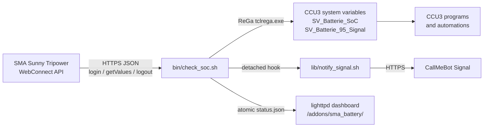

# Sentinella


Sentinella reads the battery state of charge (SoC) from an SMA Sunny Tripower or Sunny Boy Storage inverter over its local WebConnect API, writes the value to a HomeMatic CCU3 / RaspberryMatic system variable, and switches a boolean signal with 95 % / 90 % hysteresis. Signal notifications through CallMeBot are optional.

## Key facts

- Runs on a stock CCU3 or RaspberryMatic: POSIX `/bin/sh`, BusyBox `ash`, `curl`, `sed`, lighttpd.
- No Python, Node.js, build step or external CDN on the CCU.
- Under 60 KB compressed; about 275 KB installed under `/usr/local/`, including the dashboard copy.
- One login, read and logout cycle every two minutes via cron.
- A failed, missing or out-of-range reading never overwrites the last valid SoC.
- Dashboard and settings UI are served by the native lighttpd instance.

## Architecture




### Runtime flow

1. `check_soc.sh` loads `.env` and validates every value.
2. A lock directory under `state/` is created. A live PID makes the new run exit quietly; a stale lock is removed.
3. The script logs in (`POST /dyn/login.json`), reads the SoC and optional power keys, and logs out (`POST /dyn/logout.json`). The cycle is retried up to `SMA_RETRIES` times.
4. The SoC must be an integer from 0 to 100. Invalid values stop the run and leave the CCU3 variables untouched.
5. Hysteresis is evaluated against the persisted state. Between the thresholds the previous state is held.
6. Both CCU3 variables are written with one `tclrega.exe` request.
7. `state/status.json` is updated atomically and, when enabled, copied to the lighttpd directory.
8. On a state transition, `lib/notify_signal.sh` starts in the background. Cron never waits for the notification.


## Requirements

### CCU3 / RaspberryMatic

- Current CCU3 or RaspberryMatic firmware with ReGaHSS on port `8181`.
- `curl`, `sed`, `tr`, `cut`, `head`, `tail`, `date` and `logger`, all part of the standard image.
- Root SSH access for installation.
- About 275 KB of persistent space under `/usr/local/`, including the dashboard copy.

### SMA inverter

- Reachable from the CCU3 over HTTPS.
- A WebUI account with read access. The installer role `usr` is the default; `user` also works.
- The battery is visible in the inverter WebUI. The standard SoC channel is `6100_00295A00`; some firmware versions expose a different key (see [docs/PROTOCOL.md](docs/PROTOCOL.md)).

### Workstation

Only needed for `deploy.sh` and the tests: `bash`, `ssh`, `tar`, `curl`, Python 3.8+ and `openssl`.

## Installation

### 1. Get the code

```sh
git clone https://github.com/czett/sentinella.git
cd sentinella
```

### 2. Configure

```sh
cp .env.example .env
chmod 600 .env
${EDITOR:-vi} .env
```

At minimum set:

| Key | Meaning |
|---|---|
| `SMA_IP` | inverter address, e.g. `192.168.178.123` |
| `SMA_PASS` | inverter WebUI password |
| `CCU_IP` | `127.0.0.1` when the monitor runs on the CCU3 |
| `DEPLOY_HOST` | CCU3 address for `deploy.sh` |

`.env` must stay at mode `600`. It is already ignored by Git.

### 3. Deploy

```sh
./deploy.sh -H 192.168.178.10
```

`deploy.sh` is idempotent and performs these steps:

1. Checks the SSH connection.
2. Streams `bin/`, `lib/`, `web/`, `setup_variables.sh` and `.env` to `/usr/local/addons/sma_battery` with `tar` over SSH. No remote `rsync` is required.
3. Sets ownership to `root:root`; scripts and directories get `755`, `.env` gets `600`, dashboard files `644`, CGI endpoints `755`.
4. Installs the dashboard and settings API under `/usr/local/etc/config/addons/www/sma_battery/` and probes the CGI endpoint through lighttpd.
5. Adds the two-minute cron entry if no active entry exists, then restarts `crond`. Existing crontab lines are preserved.
6. Runs `setup_variables.sh` to create the two system variables.
7. Runs a first check and prints the dashboard URL.

An existing remote `.env` is not overwritten. A first install copies the workstation file.

Useful options:

```sh
./deploy.sh --dry-run                  # show the plan, change nothing
./deploy.sh -H ccu3.local --skip-vars  # keep existing system variables
./deploy.sh -H ccu3.local --skip-cron  # manage scheduling yourself
```

### 4. Manual installation

On the CCU3:

```sh
mkdir -p /usr/local/addons/sma_battery/state
mkdir -p /usr/local/etc/config/addons/www/sma_battery
```

From the workstation:

```sh
tar -cf - -C . bin lib web setup_variables.sh .env \
  | ssh root@ccu3 "tar -xf - -C /usr/local/addons/sma_battery"
```

On the CCU3:

```sh
cd /usr/local/addons/sma_battery
chown -R root:root .
chmod 755 bin/check_soc.sh lib/notify_signal.sh setup_variables.sh
chmod 600 .env
mkdir -p /usr/local/etc/config/addons/www/sma_battery/api
cp web/index.html web/style.css web/app.js \
   /usr/local/etc/config/addons/www/sma_battery/
cp web/api/config.cgi web/api/test_signal.cgi \
   /usr/local/etc/config/addons/www/sma_battery/api/
chmod 755 /usr/local/etc/config/addons/www/sma_battery/api/*.cgi
printf '%s\n' /usr/local/addons/sma_battery \
   > /usr/local/etc/config/addons/www/sma_battery/api/addon_dir
```

### 5. Create the system variables

```sh
cd /usr/local/addons/sma_battery
sh setup_variables.sh
```

The script is idempotent and creates:

- `SV_Batterie_SoC` — number, `0..100`, unit `%`
- `SV_Batterie_95_Signal` — boolean

Both are registered under `ID_SYSTEM_VARIABLES` and appear in **Status and Control → System variables**. A raw copy for the CCU3 script editor is in [`examples/setup_variables.rega`](examples/setup_variables.rega).

### 6. Install the cron job

With `deploy.sh`, this is done automatically. For a manual install, add the line with `crontab -e`:

```
*/2 * * * * /usr/local/addons/sma_battery/bin/check_soc.sh >/dev/null 2>&1
```

Then restart cron:

```sh
killall crond 2>/dev/null
crond
```

Verify:

```sh
crontab -l
ps | grep crond
```

A complete template is in [`examples/crontab.txt`](examples/crontab.txt). No `rc.local` entry is needed: the CCU3 starts `crond` at boot, and the root crontab persists under `/etc/crontabs/root`. If a firmware update resets it, run `./deploy.sh` again.

### 7. Open the dashboard

```
http://<ccu-address>/addons/sma_battery/
```

The first value appears after the next cron run, within two minutes. The page refreshes every 30 seconds and shows “Waiting for first measurement” until `status.json` exists. `?demo=1` renders the layout with generated data marked “Sentinella Preview Data”.

### 8. Settings in the browser

The settings button in the dashboard header opens a drawer for:

- trigger and reset SoC levels,
- the Signal switch,
- phone number or Signal UUID and CallMeBot API key,
- SMA inverter address, HTTPS port and WebUI password.

**Test notification** saves the form, then runs `lib/notify_signal.sh --test` in the background. The drawer polls for the result and reports success or failure. A test does not change `state/signal` or the alert cooldown.

**Save configuration** writes `.env` atomically: a private copy is edited and moved over the original, so a cron run always reads either the complete old or the complete new file. When Signal is enabled, a successful save immediately starts the same background test, so a wrong phone number, UUID or API key is reported without waiting for a real trigger. The form stays editable while the message is sent. The file remains `chmod 600`. Secrets are never returned to the browser: the API exposes only `signal_apikey_set` and `sma_password_set`, and an empty secret field keeps the stored value.

The API is same-origin only and validates every value: SoC `0..100`, trigger above reset, E.164 phone number or Signal UUID, host name and port range. It is served from `api/config.cgi` and `api/test_signal.cgi`. If your firmware does not execute `.cgi` files under `/addons/`, see [the CGI section in the troubleshooting guide](docs/TROUBLESHOOTING.md#settings-panel-and-cgi).

## Configuration

All keys live in `.env`. The file is sourced by `/bin/sh`; quote values, and prefer single quotes for secrets. After deployment, common settings can also be edited in the dashboard.

### Inverter

| Key | Type | Default | Description |
|---|---|---|---|
| `SMA_IP` | host | — | IPv4 address or DNS name, no scheme |
| `SMA_PORT` | int | `443` | HTTPS port of the inverter WebUI |
| `SMA_ROLE` | `usr`/`user` | `usr` | WebUI login role |
| `SMA_PASS` | secret | — | WebUI password |
| `BATTERY_SOC_KEY` | string | `6100_00295A00` | SoC channel key |
| `BATTERY_CHARGE_POWER_KEY` | string | `6100_00417800` | optional charging power key; empty disables |
| `BATTERY_DISCHARGE_POWER_KEY` | string | `6100_00417900` | optional discharging power key; empty disables |
| `SMA_TLS_VERIFY` | bool | `false` | verify the inverter certificate (`false` = `curl -k`) |
| `SMA_CONNECT_TIMEOUT` | int | `5` | TCP connect timeout in seconds |
| `SMA_MAX_TIME` | int | `15` | total request timeout in seconds |
| `SMA_RETRIES` | int | `2` | full login/read/logout cycles |
| `SMA_RETRY_DELAY` | int | `5` | seconds between attempts |

### CCU3

| Key | Type | Default | Description |
|---|---|---|---|
| `CCU_IP` | host | `127.0.0.1` | CCU address; localhost when running on the CCU |
| `CCU_REGA_PORT` | int | `8181` | ReGaHSS HTTP port |
| `SV_SOC_NAME` | identifier | `SV_Batterie_SoC` | number system variable |
| `SV_SIGNAL_NAME` | identifier | `SV_Batterie_95_Signal` | boolean system variable |
| `THRESHOLD_TRIGGER` | int 0..100 | `95` | set the signal true at or above this SoC |
| `THRESHOLD_RESET` | int 0..100 | `90` | set the signal false at or below this SoC |

`THRESHOLD_TRIGGER` must be greater than `THRESHOLD_RESET`. Variable names may contain only letters, digits and underscores.

### Notifications

| Key | Type | Default | Description |
|---|---|---|---|
| `SIGNAL_ENABLED` | bool | `false` | enable CallMeBot Signal messages |
| `SIGNAL_PHONE` | string | — | E.164 number, including `+` |
| `SIGNAL_APIKEY` | secret | — | CallMeBot API key for that number |
| `SIGNAL_API_URL` | url | CallMeBot Signal endpoint | compatible gateway |
| `SIGNAL_MESSAGE_OVERFLOW` | string | see `.env.example` | overflow message; placeholders `{SOC}`, `{TRIGGER_SOC}`, `{RESET_SOC}`, `{HOST}` |
| `SIGNAL_MESSAGE_RESET` | string | see `.env.example` | recovery message; same placeholders |
| `SIGNAL_MESSAGE_TEST` | string | see `.env.example` | text sent by `notify_signal.sh --test` |
| `SIGNAL_NOTIFY_ON_START` | bool | `false` | notify on first run if the signal is already active |
| `SIGNAL_TIMEOUT` | int | `15` | notification request timeout |
| `SIGNAL_RETRIES` | int | `2` | notification attempts |
| `SIGNAL_COOLDOWN` | int | `3600` | suppress duplicate trigger/reset messages within this many seconds |

Notifications are sent only on a hysteresis transition (`false → true` and `true → false`), after the CCU3 write succeeded. The hook is detached with `setsid`/`nohup` and never delays cron. A per-event cooldown prevents duplicates when cron runs every two minutes or a state file is lost. `curl --data-urlencode` encodes the message text, so spaces, umlauts and `ß` work on BusyBox without Python or jq. Legacy `SIGNAL_TEXT_TRIGGER`/`SIGNAL_TEXT_RESET` keys and `%SOC%`-style placeholders remain supported.

### Dashboard and logging

| Key | Type | Default | Description |
|---|---|---|---|
| `WEB_ENABLED` | bool | `true` | publish `status.json` |
| `WEB_STATUS_FILE` | path | `/usr/local/etc/config/addons/www/sma_battery/status.json` | lighttpd target |
| `WEB_HISTORY_POINTS` | int | `288` | samples kept for the chart (2 min × 288 ≈ 9.6 h) |
| `LOG_FILE` | path | `<addon>/state/check_soc.log` | local log; empty disables file logging |
| `LOG_MAX_BYTES` | int | `262144` | rotate once above this size |

### Deployment

| Key | Type | Default | Description |
|---|---|---|---|
| `DEPLOY_HOST` | host | — | CCU3 SSH host for `deploy.sh` |
| `DEPLOY_USER` | string | `root` | SSH user |
| `DEPLOY_PORT` | int | `22` | SSH port |
| `DEPLOY_ADDON_DIR` | path | `/usr/local/addons/sma_battery` | remote add-on directory |
| `DEPLOY_WEB_DIR` | path | `/usr/local/etc/config/addons/www/sma_battery` | remote dashboard directory |


## Signal behaviour

The boolean is a Schmitt trigger:


```
SoC
100 ┤
 95 ┤──────────── trigger ────────────  → true
 92 ┤            held                    (previous state unchanged)
 90 ┤──────────── reset ──────────────  → false
  0 ┤
```

- At or above `THRESHOLD_TRIGGER`, the signal becomes `true`.
- At or below `THRESHOLD_RESET`, it becomes `false`.
- Between the two, the value in `state/signal` is reused.
- If the state file is missing and the SoC is inside the dead band, the boolean is deliberately **not written**. This avoids a premature reset after a fresh install or a lost state file. The dashboard reports `signal: null` and `signal_state: "unknown"` for that run.

Fault handling is conservative:

| Condition | CCU3 SoC | CCU3 signal | Exit |
|---|---|---|---|
| valid 0..100 | written | written or held | 0 |
| `null` / missing value | unchanged | unchanged | 1 |
| non-integer / `101` / `-1` | unchanged | unchanged | 1 |
| login or `getValues` failure | unchanged | unchanged | 1 |
| ReGa request failure | unchanged | unchanged | 1 |
| another run is active | unchanged | unchanged | 0 |

## Dashboard

The dashboard is a static single-page app with no external fonts, scripts or CDNs. It reads `status.json` every 30 seconds and renders the SoC, the charging state, the hysteresis rail, battery power, the CCU write result, the last sample time, a history chart and a system register with inverter host, variable names, Signal gateway and timestamp. Mobile pull-to-refresh is supported; freshness is conveyed by the values and by a notice strip when a poll fails.


`status.json` is written atomically and contains no secrets:

```json
{
  "schema": 1,
  "generated_at": "2026-11-06T16:30:00Z",
  "generated_epoch": 1762446600,
  "host": "192.168.178.123",
  "soc": 91,
  "previous_soc": 92,
  "delta": -1,
  "charging": "discharging",
  "charge_power_w": 0,
  "discharge_power_w": 620,
  "signal": true,
  "signal_state": "held",
  "signal_notifications": true,
  "thresholds": { "trigger": 95, "reset": 90 },
  "variables": { "soc": "SV_Batterie_SoC", "signal": "SV_Batterie_95_Signal" },
  "ccu_status": "ok",
  "history": [{ "t": 1762446600, "soc": 91 }]
}
```

For a local preview without a CCU3, copy `web/status.example.json` to `web/status.json` and serve `web/` with any static server, or open the page with `?demo=1`.

If you do not want the dashboard, set `WEB_ENABLED="false"`. The monitor still writes a private snapshot to `<addon>/state/status.json`.

## SMA WebConnect notes

The complete notes, including key discovery and session limits, are in [docs/PROTOCOL.md](docs/PROTOCOL.md). The short version:

```sh
# 1. login -> sid
curl -k -sS -X POST -H 'Content-Type: application/json' \
  --data '{"right":"usr","pass":"secret"}' \
  https://192.168.178.123/dyn/login.json

# 2. read the battery SoC
curl -k -sS -X POST -H 'Content-Type: application/json' \
  --data '{"destDev":[],"keys":["6100_00295A00"],"sid":"<sid>"}' \
  'https://192.168.178.123/dyn/getValues.json?sid=<sid>'

# 3. always log out
curl -k -sS -X POST -H 'Content-Type: application/json' \
  --data '{"destDev":[],"sid":"<sid>"}' \
  'https://192.168.178.123/dyn/logout.json?sid=<sid>'
```

`6100_00295A00` is the standard battery SoC channel on Sunny Tripower and Sunny Boy Storage devices. It can vary by firmware; see the protocol notes. The optional power keys `6100_00417800` and `6100_00417900` improve the charging/discharging display but are not required. Without them, the dashboard derives the state from the SoC trend.

## Signal notifications

1. Add the CallMeBot Signal bot to your phone and activate the API key as described by CallMeBot.
2. Set the number and key in `.env`:

```sh
SIGNAL_ENABLED="true"
SIGNAL_PHONE="+491701234567"
SIGNAL_APIKEY="123456"
```

3. Run `./deploy.sh` again, or copy the updated `.env` and set mode `600`. Redeploying keeps the existing remote `.env`, so live credentials are not overwritten.
4. Test credentials and end-to-end delivery without faking a battery event:

```sh
/usr/local/addons/sma_battery/lib/notify_signal.sh --test; echo "exit=$?"
```

`--test` sends a clearly marked test message and does not read or write `state/signal`. `deploy.sh` runs the same test automatically when `SIGNAL_ENABLED="true"` and `--skip-test` is not given.


The notifier writes to the same log and to syslog with tag `sma_battery_notify`.

## Troubleshooting

The extended guide is [docs/TROUBLESHOOTING.md](docs/TROUBLESHOOTING.md). Quick checks:

```sh
# run once in the foreground
/usr/local/addons/sma_battery/bin/check_soc.sh; echo "exit=$?"

# recent log lines
tail -n 50 /usr/local/addons/sma_battery/state/check_soc.log
logread | grep sma_battery

# is cron alive?
ps | grep crond
crontab -l

# is ReGaHSS reachable?
curl -sS -o /dev/null -w '%{http_code}\n' http://127.0.0.1:8181/tclrega.exe
```

Common causes:

| Symptom | Likely cause |
|---|---|
| `login failed` / `err 401` | wrong password, wrong role, or the WebUI user is locked |
| repeated `getValues` failure | old session still open; wait a few minutes, check for duplicate cron jobs |
| `no numeric value` | battery not connected, wrong `BATTERY_SOC_KEY`, or firmware does not expose it |
| `CCU3 ReGa request failed` | ReGaHSS not running, wrong `CCU_REGA_PORT`, or CCU3 overloaded |
| variables do not exist | run `setup_variables.sh`; names are case-sensitive |
| dashboard shows “Waiting for first measurement” | first cron run has not completed, or `WEB_STATUS_FILE` is outside the lighttpd directory |
| dashboard shows “Showing last recorded state” | the latest poll failed; check cron and the log |
| inverter unreachable at night | the device may enter standby when the battery is empty; the last CCU3 value stays unchanged |
| no Signal message | phone number not in E.164 format (`+49…`), wrong API key, or CallMeBot rate limit; run `notify_signal.sh --test` and check the log |
| no log file | `LOG_FILE` is empty or points outside `/usr/local/`; the default is `<addon>/state/check_soc.log`, syslog tag `sma_battery` |

### BusyBox and CCU3 caveats

- Use `#!/bin/sh`, not bash. No `local`, arrays, `[[ ]]`, process substitution, `set -u` assumptions or `date -d`.
- The `curl` on the CCU3 may be older. The scripts use only `-sS`, `-k`, `-m`, `--connect-timeout`, `--data-binary` and `--data-urlencode`.
- `/` is read-only on the CCU3. All persistent data belongs under `/usr/local/`.
- Cron starts with a minimal environment. `check_soc.sh` sets its own `PATH`.
- Log out of SMA WebUI sessions you open manually. The inverter allows only a small number of concurrent sessions and can temporarily refuse new logins.
- A lost `state/signal` file does not cause a reset inside the dead band; the monitor holds the boolean and logs `signal=unchanged`.

## Security

- `.env` contains the inverter password and the CallMeBot API key. It is ignored by Git, deployed with mode `600`, and the script warns if the mode is wrong.
- SMA devices use a self-signed certificate by default, so `SMA_TLS_VERIFY="false"` is the working default. Set it to `"true"` only after installing a trusted certificate on the inverter.
- ReGaHSS is contacted over HTTP on the local CCU. Do not expose port `8181` to the internet.
- `status.json` contains only SoC, thresholds, variable names and the inverter host. It contains no password, session ID or API key.
- Lock and state files are mode `700`/`600`.
- The script logs in, reads and logs out in one run. No session is kept between cron invocations.

## Development and tests

```sh
# POSIX syntax
sh -n bin/check_soc.sh
sh -n lib/notify_signal.sh
sh -n setup_variables.sh

# ShellCheck (POSIX profile)
shellcheck -s sh -S style bin/check_soc.sh lib/notify_signal.sh setup_variables.sh

# Bash deployment helper
shellcheck -s bash -S style deploy.sh

# JavaScript syntax
node --check web/app.js

# End-to-end tests with mock SMA and ReGa servers
python3 tests/integration.py
```

The integration test starts a self-signed HTTPS SMA mock and an HTTP ReGa mock, then exercises successful reads, hysteresis transitions, the unknown-state hold, null and out-of-range values, login failure, the lock, `SIGTERM` logout, detached notifications and the ReGa setup payload.

### Brand assets

The imagery in [`docs/assets/`](docs/assets) follows the dashboard grid: warm paper, ultramarine fields, signal-red squares and Helvetica-set type. Files are rendered once with headless Chrome at 2× and downsampled. The dashboard does not load them at runtime.

| File | Size | Use |
|---|---|---|
| `readme-hero-banner.png` | 1280 × 420 | repository header |
| `sentinella-icon.png` | 512 × 512 | app icon and avatar |
| `favicon.ico` | 16–64 | browser shortcut |
| `feature-diagram-hysteresis.png` | 960 × 320 | dual-threshold explanation |
| `feature-card-signal.png` | 960 × 320 | CallMeBot Signal preview |
| `feature-card-native-ccu.png` | 960 × 320 | zero-dependency runtime |
| `feature-card-mobile-touch.png` | 960 × 320 | mobile dashboard behaviour |
| `feature-diagram-telemetry.png` | 960 × 280 | cron-to-Signal integration flow |
| `readme-divider-quote.png` | 1280 × 200 | section divider |
| `social-preview-og.png` | 1280 × 640 | GitHub social preview |

Use `social-preview-og.png` as the repository's social preview image in the GitHub settings. See [CONTRIBUTING.md](CONTRIBUTING.md) for coding rules.

## Migrating from the old `sma_soc` add-on

The new layout replaces `config.env` with `.env`. If no `.env` exists, the engine still falls back to `config.env` for a transition period.

| Old key | New key |
|---|---|
| `SMA_HOST` | `SMA_IP` |
| `SMA_SOC_KEY` | `BATTERY_SOC_KEY` |
| `SMA_INSECURE="1"` | `SMA_TLS_VERIFY="false"` |
| `SMA_INSECURE="0"` | `SMA_TLS_VERIFY="true"` |
| `SV_SIGNAL_ON` | `THRESHOLD_TRIGGER` |
| `SV_SIGNAL_OFF` | `THRESHOLD_RESET` |
| `CCU_REGA_URL` | `CCU_IP` + `CCU_REGA_PORT` |
| `SV_SOC_NAME` | unchanged |
| `SV_SIGNAL_NAME` | unchanged |

The default install directory is now `/usr/local/addons/sma_battery`; use `deploy.sh --dir` to keep the old path.

## Optional diagnostic tool

`tools/speedwire_sniffer.py` listens for SMA Speedwire multicast telegrams on `239.12.255.254:9524`. The monitor does not need it, but it helps verify that the inverter is on the network and shows whether battery-related vendor channels are present. It requires Python on the workstation, not on the CCU3.

```sh
python3 tools/speedwire_sniffer.py --interface 192.168.178.10 --count 5
```

## License

MIT — see [LICENSE](LICENSE).
